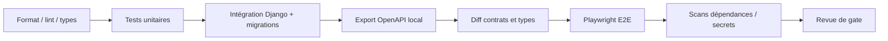

# ROADMAP - identity-reference-poc

> **Projet :** `identity-reference-poc`  
> **Document :** `ROADMAP.md`  
> **Version documentaire :** `0.1.0`  
> **Date de cadrage :** 19 novembre 2026  
> **Statut :** PROPOSÉ - plan d'exécution, aucun gate validé  
> **Décision provisoire :** GO pour construire le POC ; NO-GO pour la production tant que les preuves requises ne sont pas réunies  
> **Source principale :** `R1_DJANGO_ALLAUTH_HEADLESS_REACT_REFERENCE_IMPLEMENTATION_AND_CONTRACTS.md` (R1, sections 00 à 21)  
> **Sources complémentaires :** documentation officielle django-allauth Headless, OpenAPI et notes de version, à revérifier lors de G0

### Suivi opérationnel du 19/11/2026 (IDR-001)

- Ticket IDR-001 : **IN_REVIEW** dans [PR #2](https://github.com/tawounfouet/identity-reference-poc/pull/2).
- Branch : `chore/idr-001-bootstrap` ; lockfiles `backend/uv.lock` et `frontend/pnpm-lock.yaml` réellement committés.
- [Génération des locks](https://github.com/tawounfouet/identity-reference-poc/actions/runs/44503449515) : SUCCESS.
- [CI Django / Next.js initiale](https://github.com/tawounfouet/identity-reference-poc/actions/runs/44503580221) : SUCCESS sur `00d4d8bb12f5e7219a3a412414bc37e256ae2476`.
- **Ne pas confondre ticket IDR-001 et gate G0.** G0 reste NON VALIDÉ : IDR-002, IDR-003 et IDR-004 sont encore à réaliser. L'issue reste ouverte tant que la PR n'est pas revue/fusionnée.
- Aucun modèle User personnalisé, aucune migration, aucun parcours allauth activé pendant IDR-001.

---

## 00. Mission, principes et résultat attendu

### 00.1 Mission

Construire une **implémentation de référence exécutable**, documentée et testée de l'architecture :

```text
Next.js / React / TypeScript
       |
       | HTTPS, même origine publique, cookies de session, CSRF
       v
Django + Django REST Framework
       |-- Django Auth + django-allauth Headless (identité / authentification)
       |-- Organizations (métier)
       |-- Authorization (métier)
       |-- Security Audit (métier)
       |
       |-- PostgreSQL / Neon (stockage durable, sessions serveur)
       |-- Cache partagé (états temporaires, rate limits multi-instance)
       `-- Email transactionnel (vérification, reset, invitations)
```

L'objectif n'est **pas** de créer un nouveau fournisseur d'identité ni un framework généraliste. Il est de **prouver une architecture de référence** que SYNQENTRA, CommerceHub, LearningHub, ContentHub, ProjectHub et PIS pourront réutiliser par contrats explicites.

### 00.2 Résultats de sortie

À la clôture du POC, le dépôt devra livrer :

1. Un backend Django réellement fonctionnel, avec `AUTH_USER_MODEL` décidé avant migration et django-allauth Headless pour les parcours d'identité.
2. Un frontend Next.js/React qui pilote les parcours sans gérer de mots de passe ou de tokens de session dans `localStorage`.
3. Un routage navigateur vérifié, en **même origine publique**, protégeant sessions et mutations par CSRF.
4. Un ensemble de parcours de comptes, OAuth et MFA effectivement testés.
5. Un domaine Organizations/Authorization minimal prouvant l'isolation de deux tenants.
6. Une spécification OpenAPI extraite de **l'instance POC verrouillée**, des types frontend et des tests de compatibilité.
7. Une CI reproductible, des rapports de sécurité, une traçabilité ticket -> test -> preuve et des runbooks de base.
8. Un rapport final de décision argumenté, incluant l'option de réexaminer Djoser ou Django Auth modulaire si des blocages avérés subsistent.

### 00.3 Principes non négociables

- **Un seul propriétaire des credentials :** Django Auth + django-allauth. Pas de table utilisateurs/credentials parallèle dans Next.js.
- **`browser` pour le navigateur :** chemins `/_allauth/browser/v1/*`, session Django côté serveur et CSRF. Pas de JWT en `localStorage` comme raccourci.
- **Pas de deuxième API de login DRF :** DRF expose les endpoints métier, pas une reproduction du protocole Headless.
- **Le statut HTTP ne suffit pas :** `401` peut signifier un parcours en cours ; `meta.is_authenticated` et `data.flows` gouvernent la vue.
- **Aucune confiance dans l'UI :** permissions et isolation tenant toujours recalculées au backend.
- **Une identité n'implique pas une organisation :** accès métier seulement avec membership et policy valides.
- **OpenAPI locale comme source de vérité :** ne pas figer les types à partir de la démo publique ou de la branche de développement upstream.
- **Sécurité démontrée :** aucune fonctionnalité annoncée comme opérationnelle sans tests positifs ET négatifs.
- **Implémentation verticale d'abord :** session et révocation avant OAuth, MFA et UX avancée.

### 00.4 Hors périmètre initial

- SSO global entre plusieurs domaines applicatifs ou création d'un IdP central.
- Serveur OAuth2/OIDC maison, `allauth.idp`, tokens JWT web ou mécanisme de synchronisation inter-applications.
- Authentification mobile `app` / `X-Session-Token` et API keys de service.
- Interface de back-office entreprise complète, facturation, SCIM, provisioning avancé et délégation inter-organisations.
- SSR de données privées, BFF de login ou Server Actions qui recréent le protocole Headless.
- Migration de comptes réels, consolidation des bases utilisateurs des six applications ou déploiement directement en production.

---

## 01. Référentiel, hypothèses et décisions ouvertes

### 01.1 Référentiel de travail

| Élément | Hypothèse R1 | Action obligatoire |
|---|---|---|
| django-allauth | `65.22.1` comme photographie du 19/11/2026 | Vérifier dernière release/advisories à G0, puis figer la version choisie |
| Python / Django | Versions maintenues, compatibles avec allauth | Choisir et verrouiller versions précises, sans présumer de leur support |
| Django REST Framework | API métier uniquement | Figer version et config `SessionAuthentication` / permissions |
| Next.js / React / TypeScript | Frontend App Router | Fixer versions, paquet, lockfile et conventions |
| PostgreSQL / Neon | Identités, memberships, sessions serveur | Tester connectivité, migrations, sauvegarde et accès |
| Cache partagé | Rate limits et états éphémères cohérents | Déterminer backend retenu et tester plusieurs instances |
| Email | Fournisseur de sandbox, puis transactionnel | Vérifier délivrance, liens frontend et absence de fuite |
| Google OAuth | Premier fournisseur social | Tester callback backend et retour frontend distincts |
| Reverse proxy | Même origine par routage des chemins | Démontrer la topologie réelle et le respect des cookies |

**Interprétation :** les versions et outils ci-dessus sont des **candidats ou contraintes de référence**, non des dépendances installées ou un environnement déjà testé.

### 01.2 Décisions à prendre avant les migrations et les premières routes

| ID | Décision | Valeur de départ proposée | Date limite logique |
|---|---|---|---|
| DEC-01 | Modèle User | `AbstractUser` avec UUID interne ; `username` conservé tant que login email-only non spécifié | Avant toute migration G0 |
| DEC-02 | Identifiant de connexion | Username/email selon configuration allauth réellement activée | G0 |
| DEC-03 | Gestionnaire de dépendances Python | Un seul outil + lockfile commité (`uv` candidat) | G0 |
| DEC-04 | Gestionnaire de paquets frontend | Un seul outil + lockfile commité (`pnpm` candidat) | G0 |
| DEC-05 | Environnements | `local`, `test`, `staging` isolés ; prod non visée au démarrage | G0 |
| DEC-06 | Topologie même origine | Domaine de staging contrôlé + routage par chemins | G1 |
| DEC-07 | Service d'hébergement Django | À sélectionner, indépendamment de l'hébergement Next.js | G1 |
| DEC-08 | Session et cache | Sessions Django côté serveur ; cache partagé pour limites | G1 / G5 |
| DEC-09 | Stratégie de vérification email | Obligatoire pour les comptes locaux du POC | G2 |
| DEC-10 | Politique de MFA | Définir population cible, assurance, recovery et opérations step-up | G3 |
| DEC-11 | Identifiant RP WebAuthn | Domaine effectif après configuration proxy | G3 |
| DEC-12 | Modèle de tenant | Membership active + rôle contextualisé ; filtrage serveur | G4 |

Consigner chaque arbitrage dans `docs/adr/` ; les détails d'implémentation ne doivent pas prendre implicitement la place d'une décision.

---

## 02. Stratégie de livraison et jalons

### 02.1 Chaîne de gates


Chaque gate possède quatre états de suivi : `NOT_STARTED`, `IN_PROGRESS`, `BLOCKED` et `PASSED` (ne pas marquer `PASSED` par simple revue de code).

### 02.2 Jalons orientés preuve

| Jalon | Gate(s) | Démonstration exigée | Statut initial |
|---|---|---|---|
| M0 - Skeleton reproductible | G0 | Install, migrate, tests de base, schéma OpenAPI local | NOT_STARTED |
| M1 - Secure Browser Foundation | G1 | Même origine, cookies, CSRF positifs/négatifs | NOT_STARTED |
| **M2 - Vertical slice** | **G2** | **Login -> session -> `/api/v1/me` -> logout -> 401 métier** | **NOT_STARTED** |
| M3 - Account lifecycle | G2 | Signup, email vérifié, reset, reauth, erreurs | NOT_STARTED |
| M4 - OAuth / MFA | G3 | Google, TOTP, recovery, WebAuthn selon périmètre activé | NOT_STARTED |
| M5 - Tenant isolation | G4 | Deux organisations, rôles et refus cross-tenant | NOT_STARTED |
| M6 - Operational evidence | G5 | Multi-instance, cache, CI, observabilité, runbooks | NOT_STARTED |
| M7 - Architecture decision | G6 | Dossier de preuves et GO/NO-GO signé | NOT_STARTED |

**Ordonnancement :** séquentiel pour les gates de sécurité. Les travaux indépendants de documentation, CI, modèle métier ou tests peuvent commencer en parallèle, mais ne débloquent jamais un gate non validé.

### 02.3 Politique de scope

- **P0 - Bloquant :** comptes/sessions/CSRF, preuve d'isolation, OAuth et MFA selon fonctionnalités effectivement offertes, révocation, audit des secrets et tests de sécurité associés.
- **P1 - Important :** industrialisation des interfaces, résilience avancée, WebAuthn si expérimental, observabilité détaillée et DX. Tout P1 non fermé exige une justification explicite au gate final.
- **P2 - Évolution :** SSO inter-domaines, clients mobiles, multi-provider complet, SSR privé et service Identity centralisé.

Ne jamais rétrograder un défaut de sécurité P0 au seul motif qu'il complexifie l'implémentation.

---

## 03. Structure cible du dépôt et artefacts

```text
identity-reference-poc/
├── README.md
├── ROADMAP.md
├── .env.example
├── docs/
│   ├── references/
│   │   └── R1_DJANGO_ALLAUTH_HEADLESS_REACT_REFERENCE_IMPLEMENTATION_AND_CONTRACTS.md
│   ├── adr/
│   ├── api/
│   │   ├── allauth-browser-openapi.json
│   │   └── business-openapi.yaml
│   ├── architecture/
│   │   └── topology.md
│   ├── security/
│   │   ├── threat-model.md
│   │   ├── security-controls.md
│   │   └── test-evidence.md
│   ├── decisions/
│   │   └── GO_NO_GO.md
│   └── runbooks/
│       ├── local-development.md
│       ├── security-incident.md
│       ├── secret-rotation.md
│       └── rollback.md
├── backend/
│   ├── pyproject.toml
│   ├── manage.py
│   ├── config/
│   │   ├── settings/{base,local,test,staging}.py
│   │   └── urls.py
│   ├── apps/
│   │   ├── identities/
│   │   ├── api/
│   │   ├── organizations/
│   │   ├── authorization/
│   │   └── audit/
│   └── tests/{unit,integration,contracts,security}/
├── frontend/
│   ├── package.json
│   ├── src/app/
│   ├── src/features/{auth,organizations,authorization}/
│   └── tests/e2e/
└── .github/workflows/
    ├── backend-ci.yml
    ├── frontend-ci.yml
    ├── contracts.yml
    └── security.yml
```

**Important :** cette arborescence est **cible, non existante**. Le dépôt peut conserver une autre organisation si ses frontières et ses contrats demeurent vérifiables. Le document R1 ne doit apparaître dans `docs/references/` qu'après avoir été ajouté réellement au dépôt.

### 03.1 Livrables de documentation minima

| Document | Rôle | Gate |
|---|---|---|
| `README.md` | Installation, commandes, scope, avertissements | G0 |
| `docs/architecture/topology.md` | Schémas de flux, DNS, proxy, TLS, cookies | G1 |
| `docs/api/allauth-browser-openapi.json` | Contrat upstream issu du POC réel | G0, revalidé en CI |
| `docs/api/business-openapi.yaml` | Contrat `/api/v1/*` proposé et implémenté | G2 / G4 |
| `docs/security/threat-model.md` | Actifs, acteurs, trust boundaries, menaces | G1 |
| `docs/security/test-evidence.md` | Preuves anonymisées des contrôles P0/P1 | G1 à G6 |
| `docs/runbooks/*` | Incident, rotation, rollback, exploitation | G5 |
| `docs/decisions/GO_NO_GO.md` | Décision motivée avec réserves | G6 |

---

## 04. G0 - Foundations, baseline et contrat local

**But :** obtenir un socle local reproductible et un schéma de contrat correspondant aux dépendances réellement retenues.

### G0.A - Tâches

- [ ] Créer et initialiser `identity-reference-poc` avec les dossiers backend/frontend/docs et une CI minimale.
- [ ] Définir les versions Python, Django, django-allauth, DRF, Next.js, React et TypeScript ; vérifier compatibilité et avis de sécurité publiés au moment de l'installation.
- [ ] Adopter un lockfile Python et un lockfile frontend ; tester l'installation à froid dans un environnement isolé.
- [ ] Créer **avant la première migration** `identities.User` ; valider UUID, username/email, manager et contraintes d'unicité.
- [ ] Activer `django.contrib.auth`, `allauth.account`, `allauth.headless`, les middlewares et backends requis ; ajouter social/MFA/usersessions seulement selon le périmètre planifié.
- [ ] Configurer `HEADLESS_ONLY=True`, `HEADLESS_CLIENTS=("browser",)`, et le mapping frontend adapté à chaque environnement.
- [ ] Garder `accounts/` **et** `_allauth/` dans l'URLConf ; vérifier l'installation même si les pages Django de compte sont désactivées.
- [ ] Configurer la base de test et les paramètres de sécurité distincts des secrets de développement.
- [ ] Activer temporairement l'export OpenAPI en profil contrôlé, capturer `/_allauth/openapi.json` et le versionner.
- [ ] Générer les types TypeScript du client à partir du schéma local et les valider en CI.
- [ ] Mettre en place des tests de healthcheck, de migration et de disponibilité des routes allauth.
- [ ] Consigner ADR-001 à ADR-005 et les décisions `DEC-01` à `DEC-05`.

### G0.B - Définition de sortie

- [ ] Le clone vierge peut installer, migrer et démarrer backend et frontend avec des commandes documentées.
- [ ] Le modèle User ne nécessite aucune migration destructive initiale.
- [ ] La spec OpenAPI correspond à la version/allauth/apps réellement installées.
- [ ] Les fichiers de secrets restent hors Git ; `.env.example` ne contient aucune valeur sensible.
- [ ] CI backend/frontend/contracts initiale verte sur commit de référence.

**Preuves :** SHA commit, lockfiles, résultat `manage.py check`, migrations, liste des routes, fichier OpenAPI et journal CI.  
**NO-GO G0 :** installation non déterministe, custom User indécis, compatibilité majeure non résolue, contrat impossible à exporter.

---

## 05. G1 - Same-origin, cookies, sessions et CSRF

**But :** prouver le protocole navigateur sur une topologie utilisable, pas seulement en localhost.

### G1.A - Tâches

- [ ] Définir le routage public par chemin : pages/assets vers Next.js, `/_allauth/*`, `/accounts/*`, `/api/*` vers Django.
- [ ] Déterminer l'hébergement réel du backend Django ; documenter le chemin Cloudflare -> frontend/backend sans supposer que Vercel héberge Django.
- [ ] Préserver méthode HTTP, Host, schéma TLS, cookies, `Location`, `Set-Cookie`, Origin et corps de formulaire à travers le proxy.
- [ ] Activer cookies de session `Secure`, `HttpOnly`, `SameSite` retenu et **host-only** tant qu'aucune exception documentée ne le justifie.
- [ ] Utiliser des sessions Django stockées côté serveur ; exclure `signed_cookies` pour la baseline Headless.
- [ ] Créer l'endpoint métier **PROPOSÉ** `GET /api/v1/security/csrf` avec `ensure_csrf_cookie` et `never_cache`.
- [ ] Implémenter l'ajout de `X-CSRFToken` pour mutations `browser`, en relisant le cookie après rotation.
- [ ] Vérifier `CSRF_TRUSTED_ORIGINS`, `ALLOWED_HOSTS`, `SECURE_PROXY_SSL_HEADER`, HSTS et la chaîne de confiance proxy.
- [ ] Désactiver tout cache partagé/public pour les réponses auth, session, `/api/v1/me`, callbacks et routes émettant `Set-Cookie`.
- [ ] Tester CSRF absent/invalide, Origin hostile, cookie expiré, rotation après login et mutation immédiatement consécutive.
- [ ] Vérifier l'absence de diffusion involontaire du cookie sur un autre sous-domaine ou environnement Preview.

### G1.B - Définition de sortie

- [ ] Navigateur et serveur voient la **même origine publique** sur les routes prévues.
- [ ] Aucun cookie de session n'est accessible à JavaScript.
- [ ] Les requêtes mutantes sans protection CSRF échouent ; les requêtes valides peuvent réussir.
- [ ] Une requête privée ne peut pas être servie par le cache public.
- [ ] Une panne de session ou un en-tête proxy forgé ne crée pas d'accès autorisé.

**Preuves :** HAR **anonymisé**, inventaire des headers et cookies, tests de session/CSRF, diagramme de proxy, résultats d'inspection CDN.  
**NO-GO G1 :** CSRF désactivé, dépendance à un JWT de navigateur comme contournement, cookies non protégés ou absence de preuve de routage.

---

## 06. G2 - Parcours comptes et vertical slice

**But :** obtenir la preuve end-to-end que l'authentification produit puis révoque une session réellement utilisée par une API métier.

### G2.A - Incrément prioritaire M2 : vertical slice

- [ ] Créer `GET /api/v1/me` (**PROPOSÉ**, protégé par `IsAuthenticated`) renvoyant le principal serveur sans session ID, token ni secret.
- [ ] Créer une page Next.js de connexion et un client same-origin `credentials: 'same-origin'`.
- [ ] Démarrer par `GET /api/v1/security/csrf` pour obtenir le cookie CSRF.
- [ ] Exécuter `POST /_allauth/browser/v1/auth/login` avec body conforme au schéma local et protection CSRF.
- [ ] Lire `meta.is_authenticated` et `data.flows`, puis rafraîchir `GET /_allauth/browser/v1/auth/session`.
- [ ] Appeler `GET /api/v1/me` uniquement lorsque l'état confirmé est `authenticated`.
- [ ] Déconnecter via `DELETE /_allauth/browser/v1/auth/session` avec CSRF.
- [ ] Réappeler `/api/v1/me` : l'accès doit être refusé par le serveur.
- [ ] Automatiser ce parcours en Playwright et dans les tests d'intégration Django.

```text
[Next.js login]
   -> [GET /api/v1/security/csrf]
   -> [POST /_allauth/browser/v1/auth/login]
   -> [GET /_allauth/browser/v1/auth/session]
   -> [GET /api/v1/me = autorisé]
   -> [DELETE /_allauth/browser/v1/auth/session]
   -> [GET /api/v1/me = refusé]
```

**M2 est le premier jalon à démontrer publiquement à l'équipe.** L'interface peut rester volontairement minimale.

### G2.B - Cycle de vie complet

- [ ] `GET /_allauth/browser/v1/config` pour détecter les parcours activés.
- [ ] Signup et confirmation email obligatoire ; ne pas accorder de permissions métier avant fin du flow.
- [ ] Liens frontend de confirmation, requêtes d'inspection et confirmation des clés ; contrôler anti-fuites et usage par scanners email.
- [ ] Reset password : demande, inspection du lien/code, mise à jour, état de session et politique de révocation.
- [ ] Changement de mot de passe et reauthentification sensible selon les routes installées.
- [ ] Modéliser les états `anonymous`, `pending-email`, `pending-mfa`, `reauth-required`, `authenticated`, `unavailable`.
- [ ] Traiter 400, 401, 403, 409, 429 et incidents réseau sans boucle de retry sur les mutations sensibles.
- [ ] Vérifier les retours après refresh, navigation multi-onglets et expiration de la session.
- [ ] Tester l'absence d'énumération de comptes via signup/reset/login.

### G2.C - Définition de sortie

- [ ] La présence de `data.user` ou un HTTP 200 ne suffit pas à débloquer le dashboard.
- [ ] L'API métier refuse les utilisateurs anonymes, partiellement authentifiés ou dont la session a été révoquée.
- [ ] L'email et le reset fonctionnent réellement via le fournisseur de test et les URLs frontend.
- [ ] Les erreurs sont rendues correctement et ne divulguent pas l'existence des comptes.
- [ ] Des E2E reproductibles couvrent au minimum le vertical slice, signup/verify et reset.

**Preuves :** vidéo ou traces E2E sans secrets, rapports de tests, enveloppes JSON non sensibles, mail sandbox anonymisé.  
**NO-GO G2 :** logout inefficace, accès métier pendant un flow MFA/email, échec de rotation CSRF ou perte de contrat API.

---

## 07. G3 - OAuth social, TOTP, recovery, WebAuthn et step-up

**But :** intégrer les facteurs et les fournisseurs sans affaiblir l'authentification locale.

### G3.A - OAuth Google

- [ ] Activer le provider Google et verrouiller son app/client et ses credentials en environnement isolé.
- [ ] Utiliser un **POST de formulaire navigateur** vers `/_allauth/browser/v1/auth/provider/redirect` (`application/x-www-form-urlencoded`).
- [ ] Fournir `provider=google`, `process=login` et une `callback_url` frontend explicitement autorisée.
- [ ] Configurer **séparément** le callback OAuth **backend** `/accounts/.../callback/` auprès de Google.
- [ ] Au retour sur la page frontend, recharger `GET /auth/session` ; ne pas faire confiance à `?success=true`.
- [ ] Tester state altéré, provider incorrect, callback externe, erreur fournisseur et tentative d'account linking non consentie.
- [ ] Tester `process=connect` seulement après login et step-up adapté.

### G3.B - MFA, récupération et passkeys

- [ ] Activer `allauth.mfa` selon les options et dépendances retenues, en gardant la politique MFA documentée.
- [ ] Tester activation et authentification TOTP avec utilisateur connu, récupération et révocation des facteurs.
- [ ] Tester codes de secours : usage unique, épuisement, régénération et logs sans secret.
- [ ] Faire respecter la réauthentification/step-up avant les mutations de sécurité du compte.
- [ ] Tester MFA en attente : aucun accès métier tant que la session n'est pas complètement authentifiée.
- [ ] Activer puis tester WebAuthn/passkeys sur un domaine compatible, avec `RP ID` et policy `user verification` explicites.
- [ ] Vérifier les opérations réellement disponibles dans **l'OpenAPI local** : ne pas recopier les routes MFA/WebAuthn de mémoire.
- [ ] Vérifier les dernières notes de sécurité du package installé et l'absence de bypass des flows.

### G3.C - Définition de sortie

- [ ] OAuth ne permet ni open redirect ni confusion de provider, ni rapprochement abusif de comptes.
- [ ] TOTP et recovery ne peuvent être ignorés ou rejoués pour obtenir l'accès.
- [ ] Le step-up protège les actions retenues par la politique de sécurité.
- [ ] Les capacités WebAuthn affichées comme disponibles sont effectivement couvertes par un E2E adapté.
- [ ] Aucune clé OAuth, code OTP, clé de récupération ou code d'autorisation ne figure dans les logs ni analytics.

**Preuves :** rapport callback/state, capture des routes OpenAPI installées, rapports MFA/virtual authenticator, revue redaction.  
**NO-GO G3 :** account takeover, MFA contournable, connexion entre comptes non consentie, secret révélé ou parcours annoncé non testé.

---

## 08. G4 - Organizations, Authorization et isolation multi-tenant

**But :** démontrer que l'identité globale est indépendante des permissions métiers.

### G4.A - Modèle métier minimal

```text
User [Django Auth / allauth]
  |
  +-- Membership(user_id, organization_id, status)
  |      +-- RoleBinding(role, scope)
  |
  +-- Invitations (acceptées seulement sous conditions serveur)

Organization
  +-- Resource(organization_id, ...)
```

- [ ] Créer les modèles `Organization`, `Membership`, `Invitation`, éventuellement `RoleBinding`.
- [ ] Ajouter contraintes d'unicité, statut, expiration et révocation ; migrations testées.
- [ ] Implémenter un `IdentityPrincipal` stable détaché des types `SocialLogin`/`SocialAccount`.
- [ ] Faire dériver `actor_id` de `request.user` et non du JSON soumis.
- [ ] Construire `/api/v1/organizations/*`, `/members`, `/invitations` comme **contrats métier PROPOSÉS**.
- [ ] Évaluer `membership` et `policy` sur **chaque** lecture, mutation, recherche, export et récupération par UUID.
- [ ] Isoler l'objet au niveau de la requête ORM, avant même la vérification fine de la permission.
- [ ] Créer deux tenants A/B, un utilisateur appartenant aux deux et plusieurs rôles contextualisés.
- [ ] Prouver qu'une révocation prend effet à la **requête suivante**, même si la session utilisateur reste valide.
- [ ] Tester un rôle forgé dans le body, le changement de tenant, les erreurs 403/404 non révélatrices et les invitations expirées.

### G4.B - Scénarios de démonstration

1. Alice est membre actif de A et n'est pas membre de B : elle lit une ressource A, mais ne lit ni ne modifie la ressource B.
2. Alice appartient à A et B avec des rôles différents : son rôle dans A ne s'applique pas à B.
3. Un administrateur de A révoque Alice : la requête suivante vers A est refusée, sans toucher nécessairement à sa session globale.
4. Un utilisateur fournit un `actor_id` ou `organization_id` frauduleux : le serveur ignore ou rejette la tentative.
5. Une invitation expirée ou révoquée n'est plus consommable.

Les noms de personnes dans ces scénarios sont fictifs ; les fixtures réelles doivent rester synthétiques.

### G4.C - Définition de sortie

- [ ] Tous les accès métier protégés sont soumis à une policy backend testée.
- [ ] Les requêtes cross-tenant n'entraînent ni fuite de ligne, ni mutation.
- [ ] Les révocations sont effectives immédiatement côté métier.
- [ ] L'interface peut afficher les droits, mais ne décide jamais de l'autorisation finale.

**Preuves :** tests d'isolation tenant A/B, état DB avant/après, cas GET/POST/DELETE, matrice rôles/permissions.  
**NO-GO G4 :** une fuite cross-tenant, une révocation non appliquée ou une vérification d'accès seulement côté frontend.

---

## 09. G5 - Résilience, exploitation, conformité de livraison

**But :** distinguer une démo fonctionnelle d'un socle exploitable dans plusieurs applications.

### G5.A - Plateforme et déploiement

- [ ] Tester au minimum deux instances backend partageant le store de sessions et le cache de limitations.
- [ ] Contrôler la persistance de session pendant restart/redeploy et le comportement lors d'une panne de base/cache.
- [ ] Vérifier les rate limits sur des requêtes réparties entre instances, sans contourner l'anti-bruteforce.
- [ ] Revoir les policies de cache CDN, headers `Cache-Control`, CSP, HSTS et protection des previews.
- [ ] Tester la politique de timeout et de révocation après changement de mot de passe ou compromission simulée.
- [ ] Vérifier `manage.py check --deploy` avec les paramètres appropriés ; interpréter le résultat en fonction de l'environnement.
- [ ] Mettre en place sauvegarde/restauration et une répétition de rollback sur environnement non productif.
- [ ] Protéger l'administration Django selon une politique dédiée ; ne pas la traiter comme une UI métier ordinaire.

### G5.B - Qualité, CI, observabilité et réponse aux incidents

- [ ] Exécuter lint, format, typecheck, tests unitaires, intégration et E2E.
- [ ] Exporter OpenAPI, vérifier diff contrat et regénération des types ; exiger revue en cas de rupture.
- [ ] Scanner dépendances Python et JS, secrets, images/artefacts si concernés ; produire la liste des vulnérabilités et leur traitement.
- [ ] Journaliser les événements de sécurité utiles avec `request_id`, catégorie et résultat, mais **jamais** mots de passe, cookies, OTP, recovery codes ou tokens de provider.
- [ ] Tester la redaction via un jeu de requêtes contenant des marqueurs secrets fictifs.
- [ ] Produire une trace d'erreur exploitable sans permettre l'énumération d'utilisateurs ni la fuite des paramètres d'URL.
- [ ] Rédiger runbooks `security-incident.md`, `secret-rotation.md`, `rollback.md` et `local-development.md`.
- [ ] Documenter limites de charge, scénarios dégradés, protection contre les replays et politique de gestion des secrets.

### G5.C - Définition de sortie

- [ ] Les sessions et limitations restent cohérentes sur plusieurs instances.
- [ ] La CI bloque les ruptures contractuelles et les régressions P0.
- [ ] Les secrets sont absents des logs, des pièces de preuve, du code et des commits.
- [ ] Un rollback et une rotation de secrets sont documentés et exercés en test.
- [ ] Les vulnérabilités critiques/élevées pertinentes sont corrigées ou traitées selon un processus de risque approuvé ; aucun P0 non corrigé ne passe.

**Preuves :** traces de CI, diff OpenAPI, rapport SCA, tests multi-instance, compte rendu incident simulé, essai de restauration/rollback.  
**NO-GO G5 :** sessions non durables, anti-bruteforce contourné, fuite de secrets, régression contractuelle ou restauration non maîtrisée.

---

## 10. G6 - Arbitrage final et décision de référence

### G6.A - Dossier de décision

- [ ] Consolider les preuves par gate, ticket, test, commit SHA et environnement.
- [ ] Relever toutes les vulnérabilités et déviations ouvertes, avec mesures compensatoires et acceptation formelle si elles ne sont pas P0.
- [ ] Mesurer les parcours de référence (login, signup/verify, callback OAuth, MFA) dans un environnement défini ; fournir contexte et méthode, pas des chiffres non reproductibles.
- [ ] Évaluer l'effort d'intégration, le nombre de customisations, les dépendances, les contraintes des upgrades et le coût opérationnel.
- [ ] Comparer **à critères identiques**, sur les seuls points bloquants ou différenciants, avec Djoser + composants spécialisés et Django Auth modulaire.
- [ ] Acter une décision : `GO_REFERENCE_POC`, `GO_PRODUCTION_CANDIDATE_WITH_CONDITIONS`, `NO_GO_REWORK` ou `NO_GO_REEVALUATE_ARCHITECTURE`.
- [ ] Lister les futures tâches de généralisation multi-apps sans présumer de SSO inter-domaines.

### G6.B - Critères de GO/NO-GO

**GO de la référence technique POC** seulement si :

- [ ] G0 à G5 validés avec preuves traçables.
- [ ] Aucun risque de sécurité P0 ouvert.
- [ ] Les parcours annoncés sont couverts par tests E2E + négatifs.
- [ ] La frontière Identity / Authentication / Organizations / Authorization est démontrée dans le code.
- [ ] Les contrats peuvent être régénérés et consommés dans un frontend indépendant.

**GO d'un déploiement de production** est une décision **distincte**, exigeant notamment revue d'exploitation, DPIA/conformité selon données et usages, politique support, pentest ou revue indépendante adaptée au risque, sauvegardes vérifiées, supervision, gestion des incidents et validation des conditions réelles d'hébergement. Cette roadmap n'accorde **aucun GO production automatique**.

**NO-GO** dès qu'une preuve P0 manque, qu'une fuite cross-tenant est reproductible, qu'un bypass OAuth/MFA/CSRF existe, ou que la session n'est pas révocable.

---

## 11. Backlog maître et traçabilité aux tickets R1

Les IDs `IDR-001` à `IDR-017` sont **conservés tels quels** du backlog R1. Les sous-tâches détaillées se trouvent dans les gates correspondants.

| Ticket | Gate | Priorité R1 | Deliverable / Definition of Done abrégée | Dépend de | État |
|---|---|---|---|---|---|
| IDR-001 | G0 | P0 | Monorepo, README, versions, lockfiles, CI bootstrap | - | IN_REVIEW |
| IDR-002 | G0 | P0 | Custom User défini, migrations propres, décision login | 001 | TODO |
| IDR-003 | G0 | P0 | allauth Headless installé, URLConf et OpenAPI locale exportée | 001, 002 | TODO |
| IDR-004 | G0 | P0 | Client TS, types contractuels et mapping `flows/meta` testés | 003 | TODO |
| IDR-005 | G1 | P0 | Routage same-origin, TLS, cookies et session serveur démontrés | 003 | TODO |
| IDR-006 | G1 | P0 | CSRF bootstrap, négatifs et rotation post-login | 005 | TODO |
| IDR-007 | G2 | P0 | Login, signup, session, logout et `/api/v1/me` E2E | 004, 006 | TODO |
| IDR-008 | G2 | P0 | Vérification email, reset et reauth avec tests | 007 | TODO |
| IDR-009 | G3 | P0 | Google OAuth, deux callbacks, state/callback négatifs | 005, 007 | TODO |
| IDR-010 | G3 | P1 | TOTP, recovery codes et step-up testés | 007 | TODO |
| IDR-011 | G3 | P1 | WebAuthn/passkeys, RP ID, user verification testés | 010 | TODO |
| IDR-012 | G4 | P0 | Organization, Membership, Invitation et migrations | 002 | TODO |
| IDR-013 | G4 | P0 | Policies serveur, refus cross-tenant, révocation immédiate | 012 | TODO |
| IDR-014 | G5 | P0 | Sessions et limiteurs cohérents sur deux instances | 006 | TODO |
| IDR-015 | G5 | P1 | Audit, journalisation nettoyée et runbooks | 007, 013 | TODO |
| IDR-016 | G5 | P1 | SCA, sécurité proxy/headers, checks d'exploitation | 014, 015 | TODO |
| IDR-017 | G6 | P0 | Rapport comparatif, preuves et décision finale | Tous gates | TODO |

**Règle de gestion :** un ticket passe de `TODO` à `IN_PROGRESS`, `IN_REVIEW`, puis `DONE` uniquement avec PR, tests et preuves. Un ticket terminé ne valide pas automatiquement son gate.

### 11.1 Lots de réalisation recommandés

| Lot | Tickets dominants | Livrable de démonstration |
|---|---|---|
| L0 - Bootstrapping | 001-004 | Instance Django + Next.js + contrat local |
| L1 - Session security | 005-006 | CSRF/cookies sur origine réelle |
| **L2 - First vertical slice** | **007** | **Login -> `/me` -> logout -> refus** |
| L3 - Account recovery | 008 | Signup, email, reset, reauth |
| L4 - Advanced auth | 009-011 | OAuth, MFA, passkeys |
| L5 - Domain authorization | 012-013 | Membership et isolation A/B |
| L6 - Operational hardening | 014-016 | CI/sécurité/résilience/runbooks |
| L7 - Decision | 017 | GO/NO-GO motivé |

### 11.2 Sous-tâches transverses de référence

| Réf. | Travail | Ticket principal | Preuve |
|---|---|---|---|
| X-01 | Politique d'erreurs HTTP et transitions de flows | IDR-004 | Tests unitaires mapper |
| X-02 | Génération types TS depuis OpenAPI locale | IDR-004 | Diff et CI |
| X-03 | Revalidation session après OAuth / MFA / reset | IDR-007/009/010 | E2E |
| X-04 | Politique non-énumération et redaction | IDR-008/015 | Tests négatifs |
| X-05 | Mapping Membership -> Policy + requêtes filtrées | IDR-013 | Tests A/B |
| X-06 | Cohérence rate limits multi-instance | IDR-014 | Rapport de concurrence |
| X-07 | Scan des versions / advisory review | IDR-001/016 | SBOM / registre |
| X-08 | Dossier final de preuves | IDR-017 | `GO_NO_GO.md` |

---

## 12. Registre des contrats HTTP et ownership

### 12.1 Routes UPSTREAM allauth, à confirmer sur OpenAPI locale

| Contrat | Méthode principale | Client | Usage gate |
|---|---|---|---|
| `/_allauth/browser/v1/config` | GET | Browser | G2 |
| `/_allauth/browser/v1/auth/session` | GET / DELETE | Browser | G2 |
| `/_allauth/browser/v1/auth/login` | POST | Browser | G2 |
| `/_allauth/browser/v1/auth/signup` | POST | Browser | G2 |
| `/_allauth/browser/v1/auth/email/verify` | GET / POST | Browser | G2 |
| `/_allauth/browser/v1/auth/password/request` | POST | Browser | G2 |
| `/_allauth/browser/v1/auth/password/reset` | GET / POST | Browser | G2 |
| `/_allauth/browser/v1/auth/reauthenticate` | POST | Browser | G2/G3 |
| `/_allauth/browser/v1/auth/provider/redirect` | POST formulaire | Browser navigation | G3 |
| `/_allauth/browser/v1/auth/2fa/authenticate` | POST | Browser | G3 |
| `/_allauth/browser/v1/auth/2fa/reauthenticate` | POST | Browser | G3 |
| `/accounts/.../callback/` | GET/POST selon provider | Backend OAuth | G3 |

**Réserve :** activation et opérations exactes dépendent des apps/options. Pour sessions avancées, WebAuthn, facteurs et providers, capturer les routes exactes depuis le schéma local plutôt que les inventer.

### 12.2 Routes PROPOSÉES par notre domaine Django/DRF

| Contrat | Méthode(s) | Règle d'autorisation | Gate |
|---|---|---|---|
| `/api/v1/security/csrf` | GET | Public, no-store | G1 |
| `/api/v1/me` | GET | Session pleinement authentifiée | G2 |
| `/api/v1/organizations` | GET / POST | Session + règles d'accès/création | G4 |
| `/api/v1/organizations/{org_id}` | GET / PATCH | Membership et policy | G4 |
| `/api/v1/organizations/{org_id}/members` | GET | `members.read` | G4 |
| `/api/v1/organizations/{org_id}/invitations` | POST | `members.invite` | G4 |
| `/api/v1/organizations/{org_id}/members/{id}` | DELETE | `members.revoke` | G4 |
| `/api/v1/me/authorizations` | GET | UX uniquement, non décision souveraine | G4 |

Ne pas exposer de `/api/v1/authorization/check` générique sans étude de menace. Les contrôles doivent vivre dans les services métier côté serveur.

### 12.3 Machine à états frontend

```text
loading
  |-- anonymous
  |-- pending-email
  |-- pending-mfa
  |-- reauth-required
  |-- authenticated
  `-- unavailable
```

- `401` Headless : peut indiquer un utilisateur anonyme, une étape à compléter ou une réauthentification nécessaire.
- `meta.is_authenticated` et `data.flows` sont les signaux métier du protocole ; le statut HTTP seul n'est pas une machine à états.
- Une réponse de vérification email peut réussir puis exiger une nouvelle connexion.
- Le frontend ne doit jamais stocker `sessionid`, JWT, OTP, clés de reset, recovery codes ou secrets OAuth dans le stockage web.

---

## 13. Matrice de tests héritée de R1 (T-001 à T-028)

Les 28 identifiants sont conservés pour garantir que le passage d'une spécification R1 à un POC ne fait disparaître aucun scénario.

| Test | Gate | Scénario / preuve | Bloquant de référence |
|---|---|---|---|
| T-001 | G1 | Bootstrap CSRF émet cookie, sans cache public | Oui |
| T-002 | G1 | Login POST sans CSRF refusé | Oui |
| T-003 | G1 | Login POST avec CSRF invalide refusé | Oui |
| T-004 | G2 | Login valide, session pleinement authentifiée | Oui |
| T-005 | G2/G3 | MFA pending ne donne pas accès métier | Oui |
| T-006 | G3 | TOTP valide termine le flow | Oui si MFA activée |
| T-007 | G3 | TOTP rejoué / invalide rejeté selon policy | Oui si MFA activée |
| T-008 | G2 | Email non vérifié sans accès métier | Oui |
| T-009 | G2 | Vérification email réussie sans login interprétée correctement | Oui |
| T-010 | G2 | Reset non-énumérant pour compte inexistant | Oui |
| T-011 | G2/G5 | Anciennes sessions après reset conformes à politique | Oui |
| T-012 | G3 | OAuth state modifié échoue | Oui |
| T-013 | G3 | Callback OAuth externe / non autorisé refusé | Oui |
| T-014 | G3 | Lien fournisseur vers mauvais compte impossible | Oui |
| T-015 | G3 | Désactivation MFA sans step-up refusée | Oui si MFA activée |
| T-016 | G3 | WebAuthn sans user verification refuse selon policy | Oui si passkeys activées |
| T-017 | G2 | Logout suivi d'API métier : refus | Oui |
| T-018 | G1/G5 | Perte session/store : fail closed | Oui |
| T-019 | G4 | Révocation membership : refus sur requête suivante | Oui |
| T-020 | G4 | GET ressource cross-tenant refusé | Oui |
| T-021 | G4 | POST mutation cross-tenant sans écriture | Oui |
| T-022 | G4 | Actor forgé dans body ignoré/rejeté | Oui |
| T-023 | G5 | Deux instances backend cohérentes | Oui |
| T-024 | G1/G5 | Proxy header forgé ne provoque pas élévation | Oui |
| T-025 | G0/G5 | Diff OpenAPI détecté dans CI | Oui |
| T-026 | G2 | JSON non objet produit erreur contrôlée, pas 500 | Oui |
| T-027 | G2/G5 | Payload XSS dans profil rendu inerte | Oui |
| T-028 | G5 | Logs contenant OTP/token fictifs correctement nettoyés | Oui |

**Définition d'une preuve de test :** identifiant, commit SHA, environnement, scénario, entrée synthétique, résultat observé, assertion, statut, horodatage, lien du rapport et éventuelle issue. Aucune capture ne doit exposer de secret réutilisable.

### 13.1 Niveaux de test

- **Unitaires :** transitions de flows, fonctions de policy, validation de données, adapters sans accès réseau.
- **Intégration Django :** sessions réelles, middlewares, CSRF avec `Client(enforce_csrf_checks=True)`, SMTP sandbox et DB.
- **Contrats :** export OpenAPI allauth, diff contrôlé, types TS, schéma de l'API métier.
- **E2E Playwright :** navigateur avec origine réelle, cookies, emails, OAuth et MFA ; virtual authenticator pour WebAuthn si possible.
- **Sécurité négative :** CSRF, open redirect, state OAuth, MFA bypass, impersonation, cross-tenant, cache et redaction.
- **Exploitation :** multi-instance, dégradation DB/cache, deploy/restart, rollback et restauration.

---

## 14. CI/CD et protection des changements

### 14.1 Pipeline minimal de référence



### 14.2 Branching / PR

- `main` conserve la baseline reproductible et les preuves de gate.
- Préférer de petites PR orientées `IDR-xxx`, qui incluent tests et mise à jour des contrats.
- Protéger l'intégration contre une PR cassant migration, OpenAPI, session, CSRF ou tests inter-tenant.
- Le déploiement de staging n'ouvre pas automatiquement la production.
- Éviter les données utilisateur réelles dans tous les environnements POC.

### 14.3 Politique de changements de dépendances

1. Vérifier release notes, advisories, compatibilité Python/Django/Next.js.
2. Modifier les dépendances et lockfiles dans une PR dédiée.
3. Exporter le nouvel OpenAPI depuis la **version installée**.
4. Analyser les diffs de flows/codes HTTP/routes et régénérer les types.
5. Exécuter suite auth/CSRF/OAuth/MFA/tenant ; approuver avant merge.

---

## 15. Registre de risques et réponses

| Risque | Gravité | Déclencheur / symptôme | Réponse / gate |
|---|---|---|---|
| R-01 - CSRF ignoré | P0 | Mutation anonyme acceptée sans protection | Protection Django réelle + tests T-002/T-003, G1 |
| R-02 - Cookie exposé | P0 | JS lit la session ou domaine trop large | Secure/HttpOnly/host-only + HAR, G1 |
| R-03 - Confusion callbacks | P0 | URL frontend utilisée comme callback provider backend | Deux callbacks validés, G3 |
| R-04 - OAuth account takeover | P0 | Association sur email/état non fiables | State/provider checks et linking strict, G3 |
| R-05 - MFA bypass | P0 | API métier autorisée pendant MFA | State server + T-005/T-015/T-016, G3 |
| R-06 - Fuite cross-tenant | P0 | GET/POST inter-tenant possible | Filtrage ORM + policy + T-019/T-021, G4 |
| R-07 - Logout non révoqué | P0 | Ancienne session encore valide | Session store serveur + T-017, G2 |
| R-08 - Secrets dans logs | P0 | OTP, reset key, cookie, token en trace | Redaction systématique + T-028, G5 |
| R-09 - Rate limit incohérent | P1 | Requests alternées entre instances | Cache partagé + test concurrence, G5 |
| R-10 - Drift OpenAPI | P1 | Frontend compile mais contrat runtime change | Snapshot, diff CI, typegen, G0/G5 |
| R-11 - Cache de pages privées | P1 | CDN restitue une réponse privée | `no-store`, revue headers/CDN, G1/G5 |
| R-12 - Mauvais choix User | P0 | Migration destructive ultérieure | ADR et modèle avant `migrate`, G0 |
| R-13 - Preview/Prod confondus | P1 | Cookies/redirects traversent environnements | Isoler domaines, secrets, OAuth apps, G1/G3 |
| R-14 - Sprawl de composants | P1 | Deux systèmes de sessions ou de permissions | Ownership explicite et ADR, tous gates |
| R-15 - IdP supposé global | P1 | Confusion entre UserId partagé et SSO entre domaines | SSO hors scope, ADR-009, G6 |

Tout risque P0 découvert doit bloquer la promotion du gate concerné jusqu'à correction et test de non-régression.

---

## 16. ADR attendues et décisions de gouvernance

Reprendre les dix décisions R1 et les formaliser au format `docs/adr/ADR-XXX-*.md` :

| ADR | Décision de référence |
|---|---|
| ADR-001 | Django Auth + allauth, propriétaire unique de l'identité |
| ADR-002 | Browser sessions + CSRF, sans JWT localStorage |
| ADR-003 | Same-origin par chemins, hypothèse validée en G1 |
| ADR-004 | Pas de login DRF parallèle |
| ADR-005 | OpenAPI locale et compatibilité contractuelle |
| ADR-006 | OAuth par POST formulaire et callback backend |
| ADR-007 | Organizations et Authorization hors d'allauth |
| ADR-008 | MFA et step-up sur opérations à risque |
| ADR-009 | Pas de SSO inter-domaines en R1/POC |
| ADR-010 | Interdiction des secrets dans métriques et logs |

Chaque ADR contient : contexte, décision, options rejetées, conséquences, statut, preuves et date de revue. Une ADR peut changer si un test montre que l'hypothèse initiale est invalide, mais seulement avec justification, tests et impact estimé.

---

## 17. Definition of Done, preuves et gouvernance des gates

### 17.1 Definition of Done pour chaque ticket

- [ ] Le code et les contrats sont cohérents avec la frontière du module.
- [ ] Les tests pertinents sont ajoutés et verts ; tests négatifs pour les mutations sensibles.
- [ ] Les messages d'erreur et transitions d'état sont traités sans fuite de secret.
- [ ] Les migrations et fixtures sont reproductibles.
- [ ] Les changements d'API s'accompagnent d'une mise à jour OpenAPI/types.
- [ ] Une PR et son commit SHA sont associés au ticket.
- [ ] Les preuves sont conservées sans données de session, OTP ni identifiants personnels.

### 17.2 Gate review

Pour marquer un gate `PASSED`, enregistrer :

```yaml
# Exemple de structure documentaire ; non un workflow exécutable.
gate: G2
status: NOT_STARTED
commit_sha: null
environment: null
requirements: []
test_ids: []
evidence_links: []
open_p0: []
open_p1: []
review_decision: null
reviewed_at: null
```

La décision doit être possible à rejouer à partir du SHA, des fixtures et de l'environnement. Une capture d'écran de page de connexion ne constitue pas une validation de sécurité.

### 17.3 Règles d'issue et de blocage

- Un bug de sécurité P0 bloque la branche/release concernée.
- Une fonctionnalité P1 non incluse dans le périmètre validé doit être clairement masquée et non annoncée.
- Un changement de gate peut être annulé si une régression est découverte ultérieurement.
- Éviter de transférer une hypothèse non prouvée dans une application de production.

---

## 18. Premier cycle opérationnel à exécuter

**Ordre des premières PR recommandé :**

1. `chore: bootstrap identity-reference-poc` - structure, scripts, dépendances, CI de base, `README.md` et `ROADMAP.md`.
2. `feat(identity): establish custom User before migrations` - modèle UUID et stratégie de login validée.
3. `feat(auth): configure django-allauth headless and export OpenAPI` - apps, middleware, routes, schéma local.
4. `feat(frontend): typed browser client and authentication state mapper` - `meta`, `data.flows`, erreurs, tests unitaires.
5. `feat(security): same-origin routing and CSRF bootstrap` - cookies, proxy, session, tests négatifs.
6. `feat(auth): deliver login-session-me-logout vertical slice` - premier E2E Playwright complet.
7. `feat(account): signup email verification and password reset` - cycle de vie utilisateur.
8. `feat(auth): Google OAuth browser redirect` - provider, callbacks, tests state/linking.
9. `feat(mfa): TOTP recovery and passkeys` - facteurs, step-up, WebAuthn selon scope retenu.
10. `feat(organizations): membership and tenant policies` - isolation A/B et révocation.
11. `chore(security): resilience scanning and runbooks` - multi-instance, cache, redaction, CI.
12. `docs(decision): close POC architecture gates` - dossier de preuve et comparaison finale.

Ces intitulés de PR sont proposés ; ils ne correspondent à aucune PR actuellement créée.

### 18.1 Commandes et fichiers à documenter sans présumer de leur disponibilité

Le `README.md` doit expliquer précisément comment : installer les dépendances verrouillées, lancer la base et le cache, migrer Django, créer un compte de test, démarrer backend et frontend sous une même origine, exporter OpenAPI, exécuter pytest et Playwright, et accéder aux rapports CI.

**Ne pas écrire des commandes factices en les présentant comme validées.** Ajouter les commandes réelles une fois les outils et scripts choisis en G0.

---

## 19. Critères de valeur pour l'écosystème applicatif

L'architecture est déclarée **réutilisable** si une nouvelle application peut :

- Consommer un principal d'identité stable (`UserId`, assurance d'authentification, email vérifié) sans accéder aux secrets ni aux modèles sociaux internes.
- Brancher ses domaines et policies en conservant les garanties de session et de CSRF.
- Implémenter de nouvelles organisations/ressources sans réécrire login, reset, OAuth et MFA.
- Tester localement que ses endpoints ne fuient pas les données entre tenants.
- Mettre à jour le backend d'identité via OpenAPI versionnée et tests de compatibilité.

**Important :** ce résultat prouve la réutilisation de contrats et de pratiques, **pas** l'existence d'une session partagée entre les différents domaines de SYNQENTRA, CommerceHub, LearningHub, ContentHub, ProjectHub et PIS. Toute fédération de sessions ou SSO sera évaluée dans un ADR/projet indépendant.

---

## 20. Tableau de bord de pilotage initial

| Gate | Progression | Tickets associés | Statut | Décision |
|---|---:|---|---|---|
| G0 | 0 % | 001-004 | NOT_STARTED | Aucune |
| G1 | 0 % | 005-006 | NOT_STARTED | Aucune |
| G2 | 0 % | 007-008 | NOT_STARTED | Aucune |
| G3 | 0 % | 009-011 | NOT_STARTED | Aucune |
| G4 | 0 % | 012-013 | NOT_STARTED | Aucune |
| G5 | 0 % | 014-016 | NOT_STARTED | Aucune |
| G6 | 0 % | 017 | NOT_STARTED | Aucune |

Les pourcentages sont **des valeurs initiales documentaires**, pas des mesures issues du dépôt. Pour un suivi réel, remplacer par un indicateur calculé depuis tickets vérifiés, couverture des tests et preuves de gate. Ne pas confondre « tickets fermés » et « risque résiduel acceptable ».

### 20.1 Prochaine action immédiate

**Démarrer IDR-001, puis IDR-002 et IDR-003.** Le premier objectif utile est d'obtenir une installation reproductible et **l'OpenAPI exportée de l'instance réelle** avant toute implémentation frontend ambitieuse. Le premier jalon décisif reste **M2 : login -> session -> `/api/v1/me` -> logout -> refus**, après validation G1.

---

## 21. Sources et filiation

**Source d'exigences principale :** `R1_DJANGO_ALLAUTH_HEADLESS_REACT_REFERENCE_IMPLEMENTATION_AND_CONTRACTS.md` (19/11/2026), en particulier :

- §00-04 : cadrage, domaines, topologie, packages.
- §05-09 : Django, URLs Headless, client TS, sessions, CSRF, OAuth, MFA.
- §10-12 : contrats métier, invariants, événements et menaces.
- §13-15 : 28 tests, CI, dix ADR.
- §16-20 : backlog `IDR-001..017`, gates, DoD, séquencement et risques.

**Documentation officielle à utiliser comme preuve lors de G0 :**

- https://docs.allauth.org/en/latest/headless/installation.html
- https://docs.allauth.org/en/latest/headless/configuration.html
- https://docs.allauth.org/en/latest/headless/openapi-specification/
- https://docs.allauth.org/en/latest/headless/api.html
- https://docs.allauth.org/en/latest/release-notes/recent.html
- https://docs.djangoproject.com/en/stable/topics/auth/
- https://docs.djangoproject.com/en/stable/howto/csrf/

**Note de provenance :** ce document est une feuille de route dérivée de R1 et corroborée sur les concepts Headless essentiels par la documentation officielle. Il ajoute une organisation exécutable du travail et des critères de preuve ; il ne prétend ni que les tickets existent dans GitHub, ni que les logiciels sont déjà installés, ni que les gates ont été validés.

**Décision documentaire :** `READY_FOR_IMPLEMENTATION_PLANNING`, **pas** `PRODUCTION_READY`.