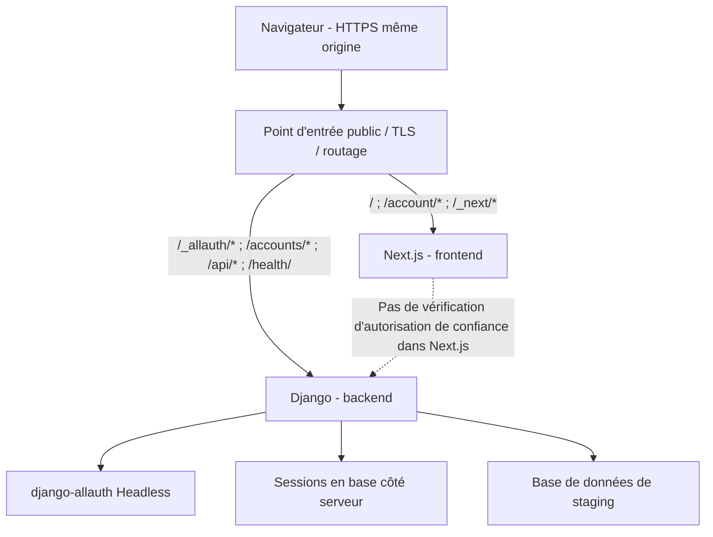

# IDR-005 - Plan d'implémentation : topologie même origine, proxy, TLS, cookies et sessions

> **Projet :** `identity-reference-poc`  
> **Ticket :** IDR-005 - G1 / P0  
> **Statut :** PLAN PROPOSÉ - aucune modification applicative ni aucun déploiement exécuté par ce document  
> **Date :** 19 novembre 2026  
> **Préconditions (historique du plan) :** IDR-001 à IDR-004 livrés ; G0 était encore `IN_REVIEW` lors de la rédaction du plan. **Actualisation : G0 PASSED sur la baseline locale via [PR #13](https://github.com/tawounfouet/identity-reference-poc/pull/13), sans validation de G1, staging ou production.**  
> **Source de vérité :** `ROADMAP.md` §05 et §17 ; `docs/references/R1_DJANGO_ALLAUTH_HEADLESS_REACT_REFERENCE_IMPLEMENTATION_AND_CONTRACTS.md` §§02-03, 05-06, 08, 12, 14 ; ADR-002 à ADR-004  
> **Dépendance aval :** IDR-006 - endpoint CSRF, cas négatifs et rotation post-login

## 00. Résumé exécutif et limite du ticket

IDR-005 établit **une seule origine visible par le navigateur** pour Next.js et Django, avec des règles vérifiables pour le proxy HTTP, TLS, les cookies et les sessions côté serveur. Le backend conserve la propriété de l'authentification et de l'autorisation ; Next.js conserve la propriété des vues et du transport typé introduit en IDR-004.

Le résultat attendu est une topologie démontrée **en local et sur une origine HTTPS de staging**, sans accès direct du navigateur à un second domaine d'API pour les parcours d'identité. Les opérations browser de django-allauth demeurent `/_allauth/browser/v1/*`. Les URLs Django `/accounts/*` doivent rester accessibles au proxy pour de futurs callbacks OAuth. Le backend n'est pas supposé être hébergé sur Vercel : son hébergeur doit être choisi et prouvé.

**Frontière ferme :** IDR-005 ne crée pas de login UI, n'active pas le signup, ne fait pas de `csrf_exempt`, n'introduit ni JWT ni stockage de session côté Next.js. Le véritable bootstrap CSRF et les tests de rotation sont les livrables IDR-006. Toute mutation reste bloquée par le client IDR-004 si le token CSRF manque. Une topologie accessible ne signifie pas que le parcours login est utilisable de bout en bout.

## 01. État constaté dans `main` avant IDR-005

| Élément | État vérifié | Conséquence |
|---|---|---|
| `frontend/next.config.ts` | `reactStrictMode` et `turbopack.root`, aucune règle `rewrites` | Ajouter un aiguillage local, sans publier l'URL d'origine backend dans le bundle client |
| `frontend/src/features/auth/api/browser-client.ts` | Chemins relatifs `/_allauth/*`, `credentials: 'same-origin'`, `cache: 'no-store'`, mutations bloquées sans `csrftoken` | Le contrat du client est compatible avec un proxy même origine ; ne pas le transformer en client CORS |
| `backend/config/urls.py` | `/health/`, `/accounts/`, `/_allauth/` | Garder les chemins identiques ; `/api/*` est réservé aux futurs endpoints Django |
| `backend/config/settings/base.py` | `SESSION_ENGINE='django.contrib.sessions.backends.db'`, middleware Security/Session/CSRF/Auth, `HEADLESS_CLIENTS=('browser',)` | Conserver sessions serveur et Headless browser |
| `backend/config/settings/local.py` | `DEBUG=True`, secret de développement, `FRONTEND_ORIGIN=http://localhost:3000` | Profil HTTP local seulement ; ne pas le réutiliser en staging |
| `backend/config/settings/staging.py` | `FRONTEND_ORIGIN` HTTPS obligatoire ; `SESSION_COOKIE_SECURE` et `CSRF_COOKIE_SECURE` activés | Compléter Host/proxy/HSTS/cookies/cache et effectuer les contrôles TLS |
| `docs/api/allauth-browser-openapi.json` | Schéma upstream gelé, 22 chemins browser | Aucun changement de contrat attendu pour le seul routage |
| `.github/workflows/ci.yml` | Tests Django, diff OpenAPI, tests TypeScript et build | Ajouter une vérification de routage/proxy sans supprimer les contrôles existants |
| `docs/gates/G0_FOUNDATIONS_STATUS_REVIEW.md` | G0 `IN_REVIEW` | Le GO de G0 est un prérequis de gouvernance à traiter, ou une dérogation documentée et approuvée |

**Éléments inconnus et non inventés :** domaine public de staging, contrôle DNS/TLS, projet Vercel opérationnel, accès et configuration Cloudflare, hébergeur Django, méthode d'accès privé à son origine, base PostgreSQL, politique de secrets, politique d'environnement Preview. Ces éléments conditionnent un déploiement réel ; le plan propose des validations, pas de ressources déjà créées.

## 02. Architecture cible et décisions

### 02.1 Invariant principal

Un navigateur qui visite `https://<staging-host>/` appelle `https://<staging-host>/_allauth/browser/v1/auth/session` **sur le même schéma, le même host et le même port public**. Il ne doit jamais appeler directement `https://<backend-internal-host>/` ni `http://localhost:8000` depuis une UI de staging.



**Convention de routage :** les chemins `/api/*` sont réservés à Django dans R1, même si les endpoints métier ne sont pas encore construits. Le chemin `/health/` est ajouté explicitement pour les sondes et les contrôles de déploiement. Toutes les routes inconnues ne doivent pas être envoyées silencieusement vers Django : le fallback UI reste Next.js.

### 02.2 Options d'implémentation, avec décision à prendre

| Option | Chaîne publique | Bénéfice | Risque/condition | Statut |
|---|---|---|---|---|
| **A - Routage d'entrée Cloudflare** | Navigateur -> Cloudflare (Worker ou règle d'origine adaptée) -> Next.js/Vercel et Django séparément | Centralise les frontières TLS, cache et routage sur le domaine contrôlé ; conforme à la cible de R1 | Il faut démontrer le support effectif du routage, la réécriture Host/forwarded, les cookies et les appels aux origines ; aucune configuration Cloudflare présumée | **Cible de référence R1, à instruire** |
| **B - Rewrites externes Next.js/Vercel** | Navigateur -> domaine Next.js/Vercel -> `rewrites` vers Django | Mise en route locale et staging potentiellement plus simple ; le navigateur voit une origine unique | Valider que la plateforme conserve les requêtes/réponses de session et les en-têtes ; politiques CDN et origines privées à prouver | **Alternative de mise en oeuvre** |
| C - Sous-domaines `app` + `api` | Navigateur -> deux hostnames | Peut répondre à des contraintes futures | Sort du choix browser initial ; nécessite une revue CORS, cookies et CSRF différente | **Non retenue pour IDR-005** |

**Décision préconisée :** commencer avec **B en local** pour prouver les chemins et la conservation du protocole, puis arrêter l'architecture de staging **A ou B** après l'inventaire réel des comptes, domaines et hébergements. Ne pas cumuler deux reverse proxies transformant les cookies sans nécessité. Si A est choisie, préférer une règle native vérifiable lorsque suffisante et recourir à Worker uniquement pour une logique impossible à exprimer autrement. Le choix final donne lieu à **ADR-006** (ou à une nouvelle décision d'architecture explicitement numérotée), en distinguant bien l'**ADR-005 encore attendu pour la clôture de G0**.

### 02.3 Table de routage contractuelle

| Méthode/chemin publics | Destination | Propriété et contrôles |
|---|---|---|
| `GET /`, `GET /account/*` | Next.js | Pages et routes UI, sans session interprétée par un proxy client |
| `GET /_next/*`, assets publics | Next.js | Cache d'assets versionnés uniquement, distinct du trafic auth |
| `GET/POST/DELETE /_allauth/browser/v1/*` | Django | Méthode et corps préservés ; réponses JSON et cookies non cachés |
| `/accounts/*` | Django | Règles pour callbacks futurs, `Location` et paramètres préservés ; aucun OAuth actuellement activé |
| `/api/*` | Django | Namespace métier réservé ; réponses privées jamais cachées |
| `GET /health/` | Django | Sonde backend, aucune fuite de secret ; définir sa visibilité publique |
| Chemin absent | Next.js ou 404 attendu | Pas de redirection magique vers le backend |

### 02.4 Contrat des frontières de confiance

- **Public** : uniquement le hostname TLS de staging, l'éventuel CDN/edge et les routes explicitement autorisées.
- **Origines** : Next.js et Django peuvent être sur des serveurs distincts ; il faut les isoler par réseau, pare-feu, secret de routage ou authentification d'origine appropriée. Une URL interne ne prouve pas une isolation réseau.
- **Proxy -> Django** : transmettre le host public ou des en-têtes de forwarding **nettoyés et réécrits par le dernier proxy de confiance** ; rejeter les versions fournies par l'internaute. N'activer `USE_X_FORWARDED_HOST` ou `SECURE_PROXY_SSL_HEADER` qu'après preuve de cette frontière et du comportement de l'hébergeur.
- **Django** : `ALLOWED_HOSTS` doit lister uniquement les hostnames permis ; la décision d'authentification réside dans Django, jamais dans Next.js ou un chemin edge.
- **Preview** : les hôtes de preview sont isolés du staging principal (cookies, secret, base, OAuth futur). Ne pas publier des previews donnant accès aux mêmes sessions ou aux mêmes données sans politique dédiée.

## 03. Politique HTTP, TLS, cookies et sessions

### 03.1 Propriétés à préserver à travers le reverse proxy

| Catégorie | Propriété vérifiée | Test prévu |
|---|---|---|
| Request line | Méthode, path, query string et body, y compris POST/DELETE et `Content-Type` | Sonde d'écho en **test uniquement**, captures expurgées ; aucun endpoint de debug exposé en staging |
| Sécurité transport | HTTPS public, TLS origine authentifié, absence de mixed content | Inspection TLS et `request.is_secure()` côté Django dans un test maîtrisé |
| Host | Host public correct, validation `ALLOWED_HOSTS` | Cas Host légitime et Host hostile ; aucun host non autorisé accepté |
| Forwarding | `X-Forwarded-Proto`, `X-Forwarded-Host` éventuel et IP client soumis à une liste de confiance | Test d'en-têtes forgés, suppression/réécriture à l'entrée, pas de pseudo-HTTPS forgé |
| Cookies | `Cookie` dans les requêtes, tous les `Set-Cookie` dans les réponses | Tests sans divulguer les valeurs des cookies ; conserver les attributs |
| Redirects | `Location`, codes 30x, chemins, host, encodage | Absence de fuite vers l'origine interne, pas d'open redirect |
| Origine | `Origin`, `Referer`, `Host` cohérents pour CSRF | Cas légitime et hostile ; couverture négative finale en IDR-006 |
| Disponibilité | Refus propre en cas d'origine indisponible | 502/503 contrôlé, pas de fuite de stacktrace/secret |
| Cache | `Cache-Control`, `Vary`, `Set-Cookie`, `Authorization` | Aucun `HIT` sur une session ou un endpoint sensible ; inspecter CDN effectif |

### 03.2 Politique de cookies proposée

| Cookie | `Secure` | `HttpOnly` | `SameSite` | `Domain` | `Path` | Statut |
|---|---|---|---|---|---|---|
| Session Django (`sessionid`, nom à confirmer) | **Oui en staging HTTPS** | **Oui** | `Lax` comme baseline à confirmer | **Absent**, cookie host-only | `/` | Obligatoire |
| CSRF Django (`csrftoken`, nom à confirmer) | **Oui en staging HTTPS** | **À confirmer selon le client IDR-004** ; lisible si extraction JS via cookie | `Lax` | **Absent**, cookie host-only | `/` | Contrat IDR-005 à préparer, tests fonctionnels en IDR-006 |

Ne jamais appliquer la politique `Secure=True` aux cookies d'un développement HTTP local en supposant qu'ils fonctionneront systématiquement. Soit **HTTP local explicitement dérogatoire**, soit **HTTPS local** avec certificat de développement approuvé pour tester les vrais attributs `Secure`.

- Conserver `SESSION_ENGINE = 'django.contrib.sessions.backends.db'` ; le passage éventuel à PostgreSQL relève de la configuration de staging et non d'un nouveau mécanisme de session.
- Aucun `SESSION_COOKIE_DOMAIN = '.example.org'` ou domaine générique. Évaluer un préfixe `__Host-` seulement après la compatibilité TLS/nom de cookie, sans imposer ce changement dans IDR-005.
- Prévoir des paramètres `SESSION_COOKIE_AGE`, `SESSION_EXPIRE_AT_BROWSER_CLOSE`, invalidation et rotation dans une politique future ; ne pas affirmer que la configuration actuelle valide les durées de session.
- Les `Set-Cookie` multi-valués doivent parvenir au navigateur comme des en-têtes distincts, sans concaténation erronée (attention aux proxies JS personnalisés).
- Les cookies d'authentification ne doivent jamais se retrouver dans des logs, HAR bruts committés ou artefacts CI publics.

### 03.3 Profil Django staging cible (à coder/tester, non activé ici)

- `DEBUG=False`, `SECRET_KEY` uniquement via secret store et origine Django non exposée sans protection.
- `SESSION_COOKIE_SECURE=True`, `SESSION_COOKIE_HTTPONLY=True`, `SESSION_COOKIE_SAMESITE='Lax'`, `SESSION_COOKIE_DOMAIN=None`.
- `CSRF_COOKIE_SECURE=True`, `CSRF_COOKIE_SAMESITE='Lax'`, `CSRF_COOKIE_DOMAIN=None` ; décision sur `CSRF_COOKIE_HTTPONLY` coordonnée avec IDR-006.
- `CSRF_TRUSTED_ORIGINS` en liste explicite d'origines HTTPS lorsque nécessaire. Ne pas adopter `*` ni une liste wildcard implicite.
- `ALLOWED_HOSTS` limité au hostname de staging effectivement vérifié et aux hôtes internes strictement nécessaires.
- `SECURE_PROXY_SSL_HEADER=('HTTP_X_FORWARDED_PROTO','https')` uniquement si le proxy de confiance **supprime** toute valeur entrante non fiable et **réémet** un header correct. Sinon, choisir une autre preuve de schéma sûre.
- `USE_X_FORWARDED_HOST=False` par défaut. L'activer uniquement si la plateforme impose ce mécanisme et si la sanitisation + allowlist du proxy sont prouvées.
- `SECURE_SSL_REDIRECT`, HSTS (`SECURE_HSTS_SECONDS`) et `SECURE_HSTS_INCLUDE_SUBDOMAINS` sont à décider après preuve que toutes les routes et origines concernées supportent HTTPS ; ne pas activer un HSTS long / includeSubDomains par simple imitation d'exemple.
- `SESSION_COOKIE_SECURE` n'implique ni test CSRF positif ni rotation : ces preuves relèvent d'IDR-006.
- Limiter les diagnostics accessibles en dehors des profils test ; interdire l'utilisation de `config.settings.spec` en staging public.

### 03.4 Politique de cache et de redirections

- `Cache-Control: private, no-store` (ou `no-store` strictement équivalent) sur `/_allauth/*`, `/accounts/*`, `/api/*` privés, réponses d'auth, reset, session et toute réponse avec `Set-Cookie`.
- Ne pas activer de règle edge « Cache Everything » couvrant le trafic dynamique. Si l'infrastructure fournit un cache par défaut pour les rewrites externes, **inspecter et invalider explicitement** la politique sur ces préfixes.
- Les fichiers statiques versionnés Next.js peuvent bénéficier des caches habituels, distincts de la politique d'auth.
- Capturer les changements de `Location` et contrôler qu'aucune redirection ne renvoie un navigateur vers un hostname privé ou de backend direct.
- Ne pas réécrire à l'aveugle les réponses OAuth à ce stade : inscrire les chemins `accounts/*` au contrat et tester les redirects avant la mise en service réelle des providers.

## 04. Plan de réalisation incrémental

### P0 - Prérequis et registre de décisions (aucun déploiement)

**Travaux**
1. Réviser le statut de sortie G0 : ADR-005 et critères de preuve. Si IDR-005 commence avant le GO G0, consigner l'exception et son responsable.
2. Inventorier domaine de staging, zone DNS, certificat, hébergement Next.js, serveur Django et accès au backend, secret store, base de sessions et environnement Preview.
3. Choisir l'option d'entrée staging (Cloudflare ou rewrites Vercel) sur la base de comportements testables, coût/complexité, restrictions réseau et garanties de headers.
4. Fixer la matrice d'origines (public staging, origines internes, local HTTP, éventuel HTTPS local, previews), les frontières de confiance et la stratégie de rollback.

**Livrables :** `docs/adr/ADR-006-same-origin-topology-and-proxy-trust.md` (numéro à confirmer), matrice des origines, diagramme DNS/TLS et décisions DEC-06/DEC-07. **Exit P0 :** aucune ambiguïté sur qui termine TLS, qui injecte les forwarding headers et quel service fournit les sessions.

### P1 - Topologie de développement reproductible

**Travaux**
1. Ajouter des `rewrites()` **côté serveur** dans `frontend/next.config.ts`, sous configuration d'environnement validée. Exemple conceptuel : `/_allauth/:path* -> http://127.0.0.1:8000/_allauth/:path*`, `/accounts/:path* -> ...`, `/api/:path* -> ...`, `/health/ -> ...` ; les parties réellement retenues doivent être vérifiées par tests et documentées.
2. Garder le navigateur sur `http://localhost:3000`, en utilisant les routes relatives définies dans `BrowserAuthClient` ; **ne pas** changer en URL absolue d'API ni publier une variable `NEXT_PUBLIC_*` d'origine interne.
3. Créer/mettre à jour le script local permettant de démarrer Django et Next.js avec des variables server-side explicites (préserver les lockfiles).
4. Documenter comment démarrer le backend, démarrer Next.js, puis vérifier `GET /`, `GET /_allauth/browser/v1/auth/session`, `GET /_allauth/browser/v1/config`, `GET /health/` depuis la **même origine**.
5. Distinguer la preuve de routage local des preuves de cookies Secure et de TLS staging.

**Livrables :** `frontend/next.config.ts`, `.env.example` / `frontend/.env.example` (placeholders non secrets), documentation locale et tests d'aiguillage. **Exit P1 :** requêtes navigateur sans CORS ni changement d'origine, réponses JSON de Django conformes et méthode/path préservés.

### P2 - Durcissement settings Django et contrats de confiance

**Travaux**
1. Formaliser la configuration staging de sessions/cookies, listes d'hôtes et origines acceptées ; ne pas injecter de valeur réelle non validée.
2. Implémenter des validations de démarrage pour les paramètres critiques (`FRONTEND_ORIGIN`, secret, host, schéma TLS, environnement) afin de **fail closed** en cas de configuration incohérente.
3. Fixer le protocole proxy -> Django : host préservé ou forwardé, schéma, IP client et en-têtes nettoyés.
4. Définir les headers de cache sur les routes Django sensibles et contrôler qu'ils survivent au reverse proxy.
5. Tester les réglages locaux vs staging sans ouvrir de véritable serveur public pendant la suite des tests unitaires.

**Livrables :** `backend/config/settings/staging.py`, `base.py` si nécessaire, tests Django de settings et de headers, `docs/security/idr-005-cookie-proxy-policy.md`. **Exit P2 :** la configuration staging rejette les host/proto non fiables, la session est côté serveur, les cookies prévus ne sont ni `Domain=*` ni lisibles par JS.

### P3 - Entrée publique HTTPS de staging et origines

**Travaux**
1. Provisionner **seulement après validation P0** l'environnement de staging, TLS, DNS, backend Django et frontend Next.js.
2. Implémenter le routage A ou B retenu : routes propres, query/body conservés, prise en charge de `Set-Cookie` multiples, pas de réécriture aveugle des redirections.
3. Protéger les origines directes et interdire l'utilisation de `X-Forwarded-*` forgés ; auditer les contournements de l'edge.
4. Vérifier à la main et automatiquement, depuis une adresse HTTPS réelle, la résolution `/`, `/_allauth/...`, `/accounts/...`, `/health/` et le chemin Django réservé `/api/*`.
5. Confirmer `request.get_host()`, `request.is_secure()` dans un **test d'intégration sécurisé**, sans publier un endpoint debug ; supprimer toute instrumentation de vérification après preuve.

**Livrables :** config IaC / edge selon solution retenue, documentation de la chaîne TLS, captures de config expurgées, `docs/architecture/topology.md`. **Exit P3 :** même origine publique prouvée sur une vraie connexion HTTPS et absence de fuite d'origine backend dans redirections/cookies.

### P4 - Campagne de sécurité et non-régression HTTP

**Travaux**
1. Écrire des tests de routes/réponses côté local et staging, avec vérification du chemin, méthodes, query, encodage, cookies et redirections.
2. Vérifier les attributs de cookies via une session de test contrôlée, sans divulguer de secret ni activer d'inscription.
3. Tester les en-têtes `Host`/`Origin`/`X-Forwarded-*` forgés, les origines non autorisées, la panne du backend, les redirections internes et les chemins non routés.
4. Tester le cache : répéter les requêtes avec deux sessions **distinctes** et prouver que les réponses privées ne sont ni cachées ni mélangées.
5. Vérifier la persistance des sessions sur le backend configuré (redémarrage application, expiration selon politique), sans prétendre démontrer de gestion de compte utilisateur complète.
6. Fournir un HAR **strictement anonymisé**, un inventaire des en-têtes (pas leurs valeurs sensibles) et un journal de CI lié au commit de PR.

**Livrables :** tests Python/TypeScript de configuration et de routage, tests d'intégration HTTPS, tableau des preuves, tests de cache, rapport de revue Host/proxy. **Exit P4 :** tous les P0 de la matrice §05 ont une preuve identifiée ou un NO-GO explicite.

### P5 - Livraison, CI et transfert IDR-006

**Travaux**
1. Exécuter les checks existants : 
   - `cd backend && uv sync --locked --group dev && uv run --locked python manage.py check && uv run --locked pytest && uv run --locked ruff check .`
   - `cd backend && uv run --locked python tools/export_headless_openapi.py --check`
   - `cd frontend && corepack pnpm install --frozen-lockfile && corepack pnpm test && corepack pnpm typecheck && corepack pnpm build`
   - `cd frontend && corepack pnpm types:generate && git diff --exit-code -- src/features/auth/api/generated/allauth.d.ts`
2. Ajouter les tests de routage et les tests de staging pertinents aux workflows CI avec préconditions explicites et secrets minimaux ; **aucune clé TLS, cookie ou secret Django en log/artefact**.
3. PR limitée à IDR-005, revue de sécurité, statut `IN_REVIEW` avant fusion ; merge seulement si critères de sortie et preuves requis sont validés.
4. Mettre à jour ROADMAP (IDR-005), ADR de topologie, schéma d'architecture et runbook de rollback.
5. Préparer IDR-006 : endpoint `GET /api/v1/security/csrf`, `ensure_csrf_cookie`, `never_cache`, requêtes POST valides/invalides, rotation après login et tests E2E de sécurité navigateur.

**Exit P5 :** PR et CI vertes, preuves TLS/headers/cookies/cache et non-contournement disponibles, rollback décrit et reproductible. Si le staging manque, **IDR-005 reste partiellement implémenté mais NON VALIDÉ**.

## 05. Matrice d'acceptation et tests négatifs prioritaires

Les identifiants ci-dessous servent de matrice de preuve pour IDR-005 ; les tests complets de protection des mutations CSRF et de rotation restent explicitement IDR-006.

| ID | Priorité | Cas | Résultat attendu | Preuve |
|---|---|---|---|---|
| T005-01 | P0 | `GET /` depuis origine unique | Page Next.js 200 et assets correspondants | Navigateur + requête HTTPS |
| T005-02 | P0 | `GET /_allauth/browser/v1/auth/session` depuis origine unique, anonyme | HTTP 401 JSON allauth ; même schéma/host/port publics | Test HTTP + navigateur |
| T005-03 | P0 | `GET /_allauth/browser/v1/config` | HTTP 200 JSON, format attendu | Test HTTP / typegen non modifié |
| T005-04 | P0 | `GET /health/` | 200 Django via la même origine, sans fuite d'origin interne | Test HTTP |
| T005-05 | P0 | POST/DELETE vers route Django en environnement test contrôlé | Méthode, path, body, query intacts à travers le proxy (la mutation peut être refusée par CSRF) | Intégration isolée |
| T005-06 | P0 | Cookie session émis en HTTPS | `Secure`, `HttpOnly`, `SameSite=Lax`, `Domain` absent, `Path=/` | Inspection navigateur/headers expurgés |
| T005-07 | P0 | Cookie CSRF de staging | `Secure`, `SameSite=Lax`, host-only ; `HttpOnly` cohérent avec contrat G1 | Inspection navigateur, preuve fonctionnelle finale en IDR-006 |
| T005-08 | P0 | Host hostile et forwarded host/proto forgés | Rejet ou sanitisation ; aucune émission de session sous une origine étrangère | Tests Django + proxy |
| T005-09 | P0 | HTTP public vers HTTPS | Redirection sûre, pas de boucle, pas de token en clair | Test HTTPS/TLS |
| T005-10 | P0 | Deux utilisateurs/sessions distincts | Aucun cache partagé sur session ou donnée privée | Inspection cache et headers CDN |
| T005-11 | P0 | Backend indisponible | Échec propre, pas d'authentification apparente, pas de stacktrace | Test de panne staging |
| T005-12 | P0 | Réponse `Set-Cookie` et `Location` du backend | Attributs conservés, pas d'host interne dans le navigateur | Tests intégration |
| T005-13 | P1 | Preview distinct du staging | Cookies / secrets / DB isolés | Contrôle des environnements |
| T005-14 | P1 | Appel direct au backend en contournant l'edge | Refus ou garde-fou d'origine et accès selon la politique documentée | Audit réseau |
| T005-15 | P0 | Mutation sans token CSRF côté client IDR-004 | `CSRF_NOT_READY`, zéro appel HTTP (régression conservée) | Tests TypeScript existants |
| T005-16 | P0 / IDR-006 | Mutation CSRF absente/invalide/Origin hostile | 403, aucune mutation | **Bloquant pour GO G1, réalisé en IDR-006** |
| T005-17 | P0 / IDR-006 | CSRF valide + rotation après login | Succès puis nouveau token utilisé | **Bloquant pour GO G1, réalisé en IDR-006** |

**Interprétation :** un test HTTP 200 avec `response.json()` ne valide ni le TLS, ni les attributs d'un vrai cookie, ni l'isolation des sessions. La preuve doit être prise au bon niveau (unit Django, intégration proxy, navigateur HTTPS).

## 06. Arborescence de travail prévue

```text
identity-reference-poc/
  frontend/
    next.config.ts                  # rewrites de développement ou déploiement retenu
    .env.example                   # variables server-side, sans secrets
    tests/                         # tests de routage/cookies/absence de CORS
  backend/
    config/settings/base.py        # modifications minimales
    config/settings/local.py       # dérogations locales explicites
    config/settings/staging.py     # HTTPS, sessions, cookies, proxy trust
    tests/                         # settings, host/headers, cache et routes
  infra/                            # uniquement après décision A ou B
    ...                             # règles/worker/config de déploiement revus
  docs/
    architecture/topology.md       # DNS, origine, requête-réponse, frontières
    security/idr-005-cookie-proxy-policy.md
    security/test-evidence/idr-005/  # captures anonymisées, checklists
    adr/ADR-006-same-origin-topology-and-proxy-trust.md
    plans/IDR_005_SAME_ORIGIN_TOPOLOGY_IMPLEMENTATION_PLAN.md
  .github/workflows/ci.yml
  ROADMAP.md
  README.md
```

**Ne pas créer d'emblée tous ces fichiers :** c'est un inventaire de livrables potentiels. Une seule stratégie d'edge doit être effectivement retenue et versionnée. Les artefacts avec secrets ne seront jamais committés.

## 07. Risques, mitigations et NO-GO

| Risque | Gravité | Mesure | NO-GO si... |
|---|---|---|---|
| `X-Forwarded-Proto/Host` contrôlé par le client | P0 | Nettoyage au proxy de confiance, allowlist et tests falsification | Django accepte une origine forgée comme sûre |
| Cookie session sans `Secure`/`HttpOnly` ou domaine trop large | P0 | Cookies host-only et inspection navigateur HTTPS | Cookie session visible par JS ou réutilisable entre previews |
| Cache CDN d'une réponse authentifiée | P0 | No-store sur chemins sensibles, vérification réelle CDN | Réponse privée cacheable / fuite inter-session |
| Callback/redirection vers l'origine Django interne | P0 | Vérifier `Location`, host et scheme | Navigateur sort de l'origine publique sans intention explicite |
| Route `accounts/` cassée | P1 | Tester les réponses HTTP même avant OAuth | Callback non routable (à corriger avant G3) |
| Politique `Secure=True` copiée en localhost HTTP | P1 | Distinguer profils local HTTP, local TLS et staging HTTPS | Tests locaux présentés comme preuve staging |
| Double-proxy Cloudflare + Vercel non maîtrisé | P0 | N'autoriser qu'une chaîne de confiance documentée | Impossible d'identifier l'acteur qui réécrit Host/Forwarded/Set-Cookie |
| Backend public accessible en contournement | P0 | Contrôle d'origine + filtre d'accès | Exposition non acceptée et non documentée |
| Couplage prématuré de CSRF | P0 | Garde-fou IDR-004 conservé, bootstrap IDR-006 | Désactivation CSRF ou login réputé fonctionnel sans preuve |
| G0 non formellement terminé | Gouvernance | ADR-005 + audit G0 ou dérogation motivée | Impossible de démontrer que G1 respecte les prérequis reconnus |

## 08. Critères de décision GO / NO-GO IDR-005

**GO IDR-005** uniquement si :
1. La topologie est définie et prouvée, en local **et en HTTPS de staging**, avec un domaine public unique et une chaîne de confiance documentée.
2. Les routes UI et Django arrivent aux bons services, avec méthodes/body/host/scheme/redirects/cookies préservés.
3. Les cookies session sont `Secure`, `HttpOnly`, host-only et sous une politique `SameSite` validée ; le CSRF cookie a une politique documentée compatible avec IDR-006.
4. Les en-têtes host/proxy forgés n'amènent ni authentification ni fausse preuve HTTPS.
5. Le cache CDN ne sert jamais de données d'auth/sessions privées.
6. Les tests P0 applicables sont verts ; SHA, logs, captures anonymisées et review de sécurité sont liés à la PR.
7. Le plan de rollback est testé ou au minimum exercé sur une configuration de staging réversible (retour au routage précédent, invalidation des caches, restauration de la configuration et contrôle des sessions).

**NO-GO IDR-005** si staging HTTPS réel absent, des headers forwarding non fiables sont traités comme sûrs, cookies non protégés, réponses auth cachables, ou la chaîne TLS/Host/Set-Cookie n'est pas démontrée. Une CI verte ne remplace pas ces preuves.

**GO G1 (plus tard)** exigera **en plus IDR-006** : bootstrap CSRF réel, refus des tokens absents/invalides, rotation post-login, vérification Origin/Referer et tests browser E2E positifs et négatifs. Même un GO G1 ne serait pas un GO production.

## 09. Gouvernance, branches et tâches opérationnelles

- Issue : `IDR-005` à créer lors du lancement de l'implémentation ; dépend de IDR-003 et s'appuie sur IDR-004. **Ce plan seul n'ouvre pas une issue ni ne change l'état de ROADMAP.**
- Branche proposée : `feat/idr-005-same-origin-topology` depuis `main`, après la revue du plan.
- PR 1 (optionnelle) : config locale rewrites + tests d'aiguillage + documentation de la matrice.
- PR 2 : configuration staging et routage edge/TLS après validation DEC-06/07.
- PR 3 (si nécessaire) : preuves de sécurité/CI et revue Go/No-Go IDR-005.
- Conserver l'ADR-005 du gate G0 distinct de l'ADR spécifique à la topologie G1 ; ne pas réutiliser un numéro existant par erreur.
- Sans accès réel aux ressources Cloudflare/Vercel/backend, le développement et les tests locaux peuvent avancer, mais le statut doit rester **IN_PROGRESS / NO-GO staging**.

## 10. Références

### Documents internes effectivement consultés

1. [`ROADMAP.md`, §05 G1 et lignes IDR-005 / IDR-006](https://github.com/tawounfouet/identity-reference-poc/blob/main/ROADMAP.md)
2. [`R1_DJANGO_ALLAUTH_HEADLESS_REACT_REFERENCE_IMPLEMENTATION_AND_CONTRACTS.md`, §§02-03, 05-06, 08, 12](https://github.com/tawounfouet/identity-reference-poc/blob/main/docs/references/R1_DJANGO_ALLAUTH_HEADLESS_REACT_REFERENCE_IMPLEMENTATION_AND_CONTRACTS.md)
3. [`docs/gates/G0_FOUNDATIONS_STATUS_REVIEW.md`](https://github.com/tawounfouet/identity-reference-poc/blob/main/docs/gates/G0_FOUNDATIONS_STATUS_REVIEW.md)
4. `backend/config/settings/{base,local,staging}.py`, `backend/config/urls.py`, `frontend/next.config.ts`, `frontend/src/features/auth/api/browser-client.ts`, `.github/workflows/ci.yml` à l'état de `main` le 19/11/2026.

### Sources officielles externes consultées pour l'architecture

- Django 5.2, settings / `SECURE_PROXY_SSL_HEADER` / cookies / CSRF : https://docs.djangoproject.com/en/5.2/ref/settings/
- Django 5.2, sécurité Host et proxies : https://docs.djangoproject.com/en/5.2/topics/security/
- Next.js 16, rewrites : https://nextjs.org/docs/app/api-reference/config/next-config-js/rewrites
- Next.js 16, Proxy : https://nextjs.org/docs/app/getting-started/proxy
- Vercel, rewrites vers origines externes : https://vercel.com/docs/routing/rewrites
- Cloudflare, Workers/routes et règles : https://developers.cloudflare.com/workers/configuration/routing/routes/ ; https://developers.cloudflare.com/rules/
- Cloudflare, cache dans Workers : https://developers.cloudflare.com/workers/cache/

**Règle de traçabilité :** les chemins et décisions R1 sont des exigences de référence ; la sélection définitive des ressources Cloudflare/Vercel, les attributs réellement émis sur staging, les tests d'origine et les résultats de CI sont des preuves **à produire durant l'implémentation**, pas des faits déjà acquis.