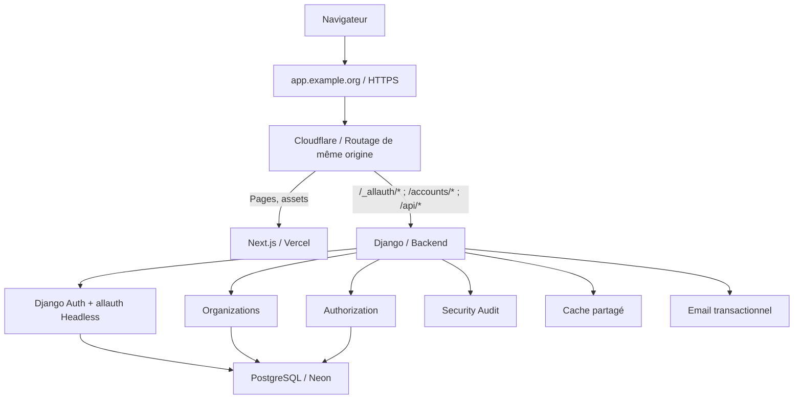
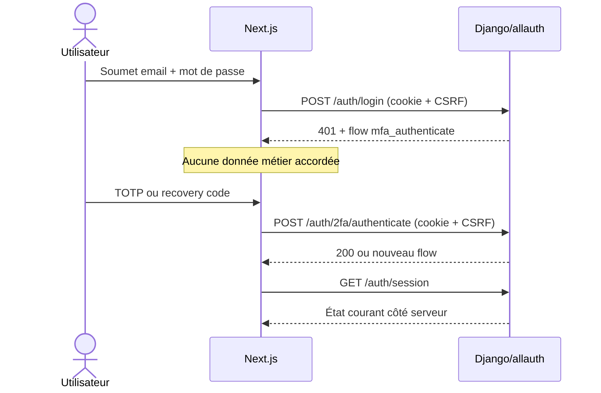
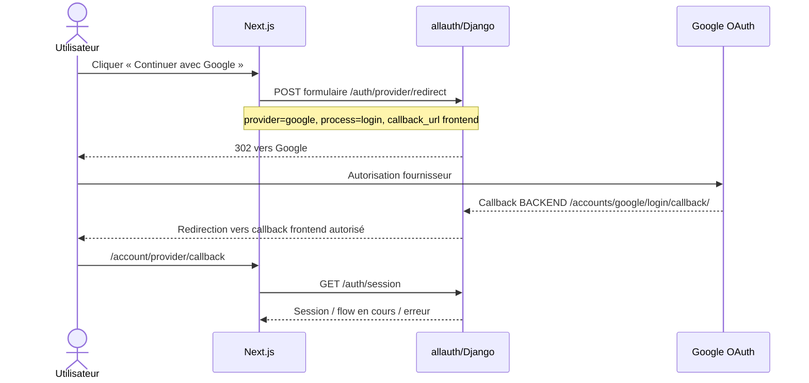
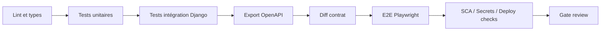

# R1 - DJANGO ALLAUTH HEADLESS REACT REFERENCE IMPLEMENTATION AND CONTRACTS

**Nom de livraison :** `R1_DJANGO_ALLAUTH_HEADLESS_REACT_REFERENCE_IMPLEMENTATION_AND_CONTRACTS.md`  
**Date :** 19 novembre 2026  
**Statut :** spécification de référence proposée, non implémentée et non validée sur un déploiement réel  
**Décision par défaut :** Django Auth + django-allauth Headless + Next.js, monolithe modulaire, sessions navigateur côté serveur  
**Version documentaire upstream :** django-allauth 65.22.1 (13 novembre 2026), documentation officielle `latest` vérifiée le 19 novembre 2026  
**Source précédente :** `R1_DJANGO_ALLAUTH_HEADLESS_NEXTJS_TECHNICAL_FIT_AUDIT_AND_POC.md`  
**Périmètre métier :** socle d'identité réutilisable pour SYNQENTRA, CommerceHub, LearningHub, ContentHub, ProjectHub et PIS

> **Nature de ce livrable :** document d'ingénierie de référence. Les blocs de configuration sont des bases à adapter, les blocs d'API métier sont des propositions internes, et les exemples de réponses upstream sont illustratifs. Aucune application n'a été déployée ni aucun test exécuté dans le cadre de ce document. Ne pas prendre ce document pour une attestation de sécurité ou une preuve d'intégration.

---

## 00. Résumé exécutif et décisions de cadrage

Le présent R1 transforme l'audit d'aptitude précédent en **spécification de référence exploitable** pour intégrer le moteur d'identité `django-allauth` à une interface Next.js/React, sans construire un deuxième système de comptes ni un fournisseur de tokens propriétaire. La valeur ajoutée réside dans les frontières métier, les contrats, l'orchestration des états de parcours, les contrôles de sécurité, les tests de conformité et le déploiement.

**Décisions centrales :**

1. `django-allauth Headless` n'est pas une alternative indépendante de `django-allauth`. C'est son interface API destinée aux clients sans templates Django.
2. Pour les navigateurs, utiliser le client **`browser`**, les cookies de session Django, la protection CSRF et un point d'entrée **même origine publique** pour le premier POC.
3. Réserver `app` et `X-Session-Token` aux clients non navigateurs. N'introduire ni JWT ni localStorage de tokens comme contournement d'une topologie mal configurée.
4. Ne pas dupliquer les endpoints natifs d'authentification dans DRF. Conserver DRF pour les fonctionnalités métier `me`, `organizations`, `memberships`, `authorization` et `audit`.
5. Définir un modèle `User` personnalisable avant toute première migration, de préférence avec PK UUID interne opaque. Ne jamais utiliser l'email comme clé d'identité permanente.
6. Isoler `Identity`, `Authentication`, `Organization` et `Authorization` par frontières DDD. Une connexion valide n'implique **aucun** droit sur une organisation.
7. Les parcours multi-étapes doivent être pilotés par `data.flows` et `meta.is_authenticated`, et pas uniquement par HTTP 200/401.
8. Lier la version du backend à un artefact OpenAPI exporté et à des tests contractuels. Le frontend ne doit pas inventer les champs des réponses.
9. Échelonner le POC : comptes/sessions, vérification email/reset, OAuth, MFA/WebAuthn, puis autorisations métier et conditions d'exploitation.
10. Conserver **NO-GO production** tant que cookies/CSRF, redirections OAuth, MFA, révocation, rate limits et isolation cross-tenant ne sont pas démontrés par des tests.

### 00.1 Questions auxquelles ce document répond

- Quel découpage des packages Django et des modules Next.js adopter ?
- Quelles routes appartiennent réellement à allauth, et lesquelles faut-il développer ?
- Comment réaliser le bootstrap CSRF et la reconnexion d'une SPA sans exposer les sessions ?
- Comment orchestrer les flux `login`, `signup`, `verify_email`, `mfa_authenticate`, `provider_redirect` et `reauthenticate` ?
- Comment intégrer les domaines Organizations / Authorization sans dépendre des modèles internes d'allauth ?
- Comment prouver, par tests, que la topologie Vercel + Cloudflare + Neon ne compromet pas la sécurité ?

### 00.2 Hors périmètre R1

- Construction d'un serveur OIDC central partagé entre plusieurs domaines autonomes.
- Implémentation de `allauth.idp`, de JWT ou d'un serveur OAuth2 applicatif.
- Intégration d'une interface d'administration d'entreprise complète.
- Réalisation du code de production ou configuration de comptes Cloudflare, Vercel, Neon et Google OAuth.
- Confirmation de compatibilité effective d'un dépôt existant : aucun dépôt n'est audité ici.

---

## 01. Traçabilité, sources et précision des contrats

### 01.1 Sources officielles

| Référence | Source | Usage |
|---|---|---|
| S-01 | https://docs.allauth.org/en/latest/headless/installation.html | Packages, apps, routes obligatoires |
| S-02 | https://docs.allauth.org/en/latest/headless/configuration.html | HEADLESS_ONLY, clients, URLs frontend, schéma |
| S-03 | https://docs.allauth.org/en/latest/headless/openapi-specification/ | Contrats HTTP, flows, formes de réponse |
| S-04 | https://docs.allauth.org/en/latest/headless/api.html | Démo React de référence |
| S-05 | https://docs.allauth.org/en/latest/headless/cors.html | Origines et en-têtes si topologie cross-origin |
| S-06 | https://docs.allauth.org/en/latest/headless/integrations.html | DRF/Ninja pour les clients `app` |
| S-07 | https://docs.allauth.org/en/latest/headless/adapter.html | Extension contrôlée des réponses |
| S-08 | https://docs.allauth.org/en/latest/release-notes/recent.html | Corrections de sécurité 2026 |
| S-09 | https://docs.djangoproject.com/en/5.2/howto/csrf/ | Bootstrap CSRF et en-tête AJAX |
| S-10 | https://docs.djangoproject.com/en/5.2/ref/csrf/ | Défense CSRF, Origin, Referer |
| S-11 | https://docs.allauth.org/en/latest/installation/requirements.html | Versions Django/Python supportées |
| S-12 | https://docs.allauth.org/en/latest/mfa/configuration.html | Configuration MFA/TOTP/WebAuthn |
| S-13 | https://docs.allauth.org/en/latest/account/rate_limits.html | Limitation de débit |
| S-14 | https://codeberg.org/allauth/django-allauth/src/branch/main/examples/react-spa/frontend | Exemple frontend upstream (vérifier son commit exact avant réutilisation) |
| S-15 | https://api.react.demo.allauth.org/_allauth/openapi.html | Démonstration du schéma exposé (non contractuelle pour notre projet) |

> **Règle de source de vérité :** pour la livraison logicielle, générer la spécification OpenAPI sur **notre instance Django verrouillée**, puis la committer. La documentation publique est une référence d'étude ; elle ne garantit pas les options activées, les champs personnalisés ni la version installée du projet.

### 01.2 Légende de statut

- **UPSTREAM** : fonctionnalité/route décrite par django-allauth.
- **PROPOSÉ** : contrat interne à créer, dont le nom peut encore changer.
- **ILLUSTRATIF** : exemple d'implémentation, non validé par exécution.
- **P0** : absence ou échec empêchant toute promotion en production.
- **P1** : risque significatif à fermer ou à accepter explicitement avec compensation.

### 01.3 Baseline de compatibilité

La documentation allauth 65.22.1 indique Python 3.11 à 3.15 et Django >= 4.2. Pour le POC, **choisir une version Django encore maintenue et compatible**, puis figer ses correctifs de sécurité et la version Python retenue. Ne pas interpréter « compatible » comme « recommandé pour un nouveau projet ».

```text
Python/Django                Version précise à décider lors de G0
`django-allauth`             65.22.1, référence au 19/11/2026
`django-allauth[headless]`   Obligatoire
Extras social / MFA          Selon parcours activés et leurs dépendances
`django-allauth[headless-spec]` Dev / validation du contrat uniquement
DRF                          API métier, version exacte à verrouiller
PostgreSQL + psycopg         Stockage durable de comptes et sessions
Cache partagé               Rate limits et états éphémères multi-instance
Next.js + React + TypeScript Versions exactes à fixer et scanner en CI
Tests                        pytest-django, Playwright, validation OpenAPI
```

La syntaxe `pip install 'django-allauth[headless,socialaccount,mfa,headless-spec]==65.22.1'` est une **cible indicative** à résoudre dans un environnement isolé. Vérifier les noms d'extras et les versions transverses avant de figer le lockfile. Ne pas activer tous les providers par principe.

---

## 02. Vue d'ensemble et frontières d'architecture



Le domaine `app.example.org` est **fictif**. La même origine n'implique pas que Next.js et Django tournent sur le même serveur : il faut que le proxy/routage conserve le schéma, le host, les cookies, les méthodes et les chemins.

### 02.1 Boundaries DDD

| Contexte | Responsable des invariants | Fait partie d'allauth ? | Interfaces |
|---|---|---|---|
| Identity | Identité et coordonnées vérifiées | Oui, avec Django Auth | User/EmailAddress/SocialAccount |
| Authentication | Preuves, MFA, sessions, recovery | Oui | `/_allauth/browser/v1/*` |
| External Identity | Fournisseurs OAuth et liens de comptes | Oui | `/accounts/*`, API provider |
| User Session | Lecture, déconnexion, révocation | Oui avec `allauth.usersessions` | Headless + Django sessions |
| Organization | Tenants, membres, invitations | Non | `/api/v1/organizations/*` |
| Authorization | Policy check, rôles contextualisés | Non | Contrats de services Django |
| API Credentials | Clés de service, scopes | Non | API séparée, hors R1 |
| Security Audit | Logs structurés, détection, gouvernance | Non, instrumentation propre | Événements, runbooks |

### 02.2 Principes invariants

- Un `User` authentifié n'est pas automatiquement membre d'une organisation.
- `actor_id` provient de `request.user` vérifié par le serveur, jamais d'une valeur client.
- `tenant_id` est un **contexte demandé**, toujours revalidé côté serveur.
- Les rôles sont liés à une membership et jamais appliqués globalement via `is_superuser` ou `is_staff`.
- Les vérifications d'accès précèdent toute lecture ou mutation métier, y compris listes, filtres, exports et jobs.
- La révocation d'un membership doit empêcher les requêtes suivantes même si la session globale reste valide.
- Chaque application métier consomme un contrat d'identité commun et contrôle ses permissions locales.
- Le SSO multi-domaines ne se déduit pas d'une table `auth_user` partagée ; il requiert une architecture de fédération distincte.

### 02.3 Autonomie des applications

| Application | Identité commune | Autorisation propre |
|---|---|---|
| SYNQENTRA | Principal stable | Société, dossier comptable, périodes, délégations |
| CommerceHub | Principal stable | Boutique, vendeur, commandes, payouts |
| LearningHub | Principal stable | Organisme, apprenant, enseignant, cours |
| ContentHub | Principal stable | Auteur, rédacteur, éditeur, publication |
| ProjectHub | Principal stable | Organisation, projet, membre, action |
| PIS | Principal stable | Données personnelles, consentements, délégations |

Le **partage de contrat** n'impose pas que toutes les applications utilisent immédiatement le même domaine web, la même session ou le même déploiement. Cette distinction doit rester explicite dans les documents de convergence R2.

---

## 03. Stratégie de déploiement et de session

### 03.1 Topologies candidates

| Option | Exemple | Statut |
|---|---|---|
| A. Même origine et routage par chemin | `app.example.org` et préfixes `/_allauth`, `/accounts`, `/api` | **Cible G1** |
| B. Sous-domaines contrôlés | `app.example.org` / `api.example.org` | Fallback avec revue CORS, CSRF et cookies |
| C. Origines sans site commun | `app.vercel.app` / `api.example.org` | Hors choix initial pour le navigateur |

**Retenir A pour le POC**, sans présumer que le routage Cloudflare + Vercel est correctement configuré. Tester les callbacks OAuth, les redirections, `Set-Cookie`, le HTTPS de bout en bout et la politique de cache avant toute bascule.

### 03.2 Cookie de session

- Cookie de session côté navigateur avec `Secure=True`, `HttpOnly=True`, `SameSite=Lax` par défaut étudié.
- Cookie host-only si même origine : ne pas élargir `SESSION_COOKIE_DOMAIN` vers `.example.org` sans nécessité prouvée.
- État Django stocké côté **serveur** : base PostgreSQL ou moteur serveur équivalent ; ne pas employer la session Django `signed_cookies` comme base du POC allauth.
- Rafraîchir l'état client à partir du serveur après une authentification, MFA, callback OAuth, réinitialisation ou révocation.
- Politique de durée de session, expiration et logout global à documenter avant production.

### 03.3 Protection CSRF

Le cookie de session est inaccessible à JavaScript. Le cookie **CSRF** peut être accessible selon la configuration choisie. Le client envoie `X-CSRFToken` sur les mutations. Un GET initial sur une route Django explicitement décorée `ensure_csrf_cookie` permet d'amorcer le navigateur.

Les points bloquants sont : rotation du secret après login, requêtes POST après une longue session, cookies de Preview, rejet des requêtes d'origines non autorisées, et absence d'exemption CSRF de convenance.

### 03.4 SSR, Server Actions et BFF Next.js

**Choix R1 :** les parcours sensibles d'authentification sont pilotés depuis des composants Next.js côté client vers les routes Django **même origine**, avec `credentials: 'same-origin'`. L'UI protégée charge la session et les données métier auprès de Django ; la décision finale d'autorisation reste sur le backend.

Un rendu SSR privé peut être ajouté plus tard, mais il requiert un passage explicite des cookies, une absence garantie de cache des pages privées et une analyse des redirections. Ne pas introduire des Server Actions qui recréent un deuxième protocole de login, ni confondre middleware Next.js et autorisation serveur.

---

## 04. Dépendances et structure des projets

### 04.1 Organisation mono-repo recommandée

```text
identity-reference-poc/
├── README.md
├── docs/
│   ├── adr/
│   ├── api/
│   │   ├── allauth-browser-openapi.json
│   │   └── business-openapi.yaml
│   ├── security/
│   │   ├── threat-model.md
│   │   └── test-evidence.md
│   └── runbooks/
├── backend/
│   ├── pyproject.toml
│   ├── manage.py
│   ├── config/
│   │   ├── settings/{base,local,production}.py
│   │   ├── urls.py
│   │   └── wsgi.py
│   ├── apps/
│   │   ├── identities/            # User, adapters, signaux contrôlés
│   │   ├── api/                   # CSRF bootstrap / health / me
│   │   ├── organizations/         # Organization, Membership, Invitation
│   │   ├── authorization/         # Policies et permissions
│   │   └── audit/                 # Événements de sécurité
│   └── tests/
│       ├── integration/
│       ├── contracts/
│       └── security/
├── frontend/
│   ├── package.json
│   ├── src/app/
│   │   ├── (auth)/account/login/page.tsx
│   │   ├── (auth)/account/signup/page.tsx
│   │   ├── (auth)/account/verify-email/[key]/page.tsx
│   │   ├── (auth)/account/password/reset/page.tsx
│   │   ├── (auth)/account/password/reset/key/[key]/page.tsx
│   │   ├── (auth)/account/mfa/page.tsx
│   │   ├── (auth)/account/provider/callback/page.tsx
│   │   ├── (account)/account/settings/security/page.tsx
│   │   └── (app)/dashboard/page.tsx
│   ├── src/features/auth/
│   │   ├── api/
│   │   │   ├── client.ts
│   │   │   ├── types.ts
│   │   │   └── flows.ts
│   │   ├── hooks/
│   │   ├── components/
│   │   └── state/
│   ├── src/features/organizations/
│   ├── src/features/authorization/
│   └── tests/e2e/
└── .github/workflows/
    ├── backend-ci.yml
    ├── frontend-ci.yml
    ├── contracts.yml
    └── security.yml
```

**Convention de routage :** les segments `(auth)` et `(account)` sont des groupes de routes Next.js (invisibles dans les URLs). Les fichiers ci-dessus produisent bien les chemins `/account/signup`, `/account/verify-email/{key}`, `/account/password/reset`, `/account/password/reset/key/{key}` et `/account/provider/callback`, conformément à `HEADLESS_FRONTEND_URLS`. Le paramètre de route Next.js `[key]` doit être traité comme un secret et ne pas être imprimé dans des logs.

**Note :** cette arborescence est une **proposition**, pas une transcription du dépôt officiel React SPA. Le dépôt amont reste une source d'apprentissage pour les patterns `AuthContext`, routing et gestion des flows ; il n'est pas un kit Next.js prêt à la production.

### 04.2 Composition backend

- **Django Auth** : système d'identité, sessions, groupes système.
- **allauth.account** : inscription, login, email, reset, réauthentification.
- **allauth.headless** : protocole HTTP pour React/Next.js.
- **allauth.socialaccount** : Google et providers activés à la demande.
- **allauth.mfa** : TOTP, récupération, WebAuthn selon configuration.
- **allauth.usersessions** : visibilité et actions de session selon configuration.
- **DRF** : API métier uniquement, `SessionAuthentication` + permissions serveurs ; ne pas supposer que les vues de connexion DRF anonymes sont protégées sans vérification.
- **PostgreSQL/Neon** : sessions serveur, comptes et domaines métier.
- **Cache partagé** : limiteurs, synchronisation d'état multi-processus, selon les paramètres documentés.

### 04.3 Règles de dépendances

- Les domaines métier peuvent importer des abstractions d'identité internes (`Actor`, `Principal`, `UserId`), **pas** directement le format `SocialLogin` d'allauth.
- `identities` peut posséder un adapter allauth, jamais une table de mots de passe parallèle.
- `authorization` doit être testable sans fournisseur OAuth et sans navigateur.
- Les handlers d'événements de signup ne doivent pas automatiquement accorder un accès global à toutes les applications.
- Les handlers non critiques peuvent être asynchrones, mais les vérifications d'accès doivent être synchrones/transactionnelles.

---

## 05. Configuration Django de référence (ILLUSTRATIF)

### 05.1 Prérequis indispensables

Créer un modèle utilisateur custom avant `migrate`. Définir le `SITE_ID` et `django.contrib.sites` seulement si la configuration allauth/les providers retenus l'exigent ; ne pas multiplier la configuration de sites inutilement.

### 05.2 Modèle utilisateur minimal

```python
# backend/apps/identities/models.py
import uuid

from django.contrib.auth.models import AbstractUser
from django.db import models


class User(AbstractUser):
    id = models.UUIDField(primary_key=True, default=uuid.uuid4, editable=False)
    # Les colonnes restantes d'AbstractUser sont conservées dans ce POC.
```

Ce choix conserve le champ `username` de `AbstractUser`. Une stratégie email-only exigerait un modèle, un manager et une politique de login spécifiques ; ce n'est pas obtenu en supprimant arbitrairement `username`. **Décider avant la toute première migration**.

### 05.3 Paramètres représentatifs

```python
# config/settings/base.py ; extrait, PAS un settings.py complet
INSTALLED_APPS = [
    "django.contrib.admin",
    "django.contrib.auth",
    "django.contrib.contenttypes",
    "django.contrib.sessions",
    "django.contrib.messages",
    "django.contrib.staticfiles",
    "rest_framework",
    "allauth",
    "allauth.account",
    "allauth.headless",
    "allauth.socialaccount",
    "allauth.socialaccount.providers.google",
    "allauth.mfa",
    "allauth.usersessions",
    "apps.identities",
    "apps.organizations",
    "apps.authorization",
    "apps.api",
]

MIDDLEWARE = [
    "django.middleware.security.SecurityMiddleware",
    "django.contrib.sessions.middleware.SessionMiddleware",
    "django.middleware.common.CommonMiddleware",
    "django.middleware.csrf.CsrfViewMiddleware",
    "django.contrib.auth.middleware.AuthenticationMiddleware",
    "django.contrib.messages.middleware.MessageMiddleware",
    "django.middleware.clickjacking.XFrameOptionsMiddleware",
    "allauth.account.middleware.AccountMiddleware",
]

AUTH_USER_MODEL = "identities.User"   # À adapter au label réel de l'app.
AUTHENTICATION_BACKENDS = [
    "django.contrib.auth.backends.ModelBackend",
    "allauth.account.auth_backends.AuthenticationBackend",
]

HEADLESS_ONLY = True
HEADLESS_CLIENTS = ("browser",)
HEADLESS_FRONTEND_URLS = {
    "account_confirm_email": "https://app.example.org/account/verify-email/{key}",
    "account_reset_password": "https://app.example.org/account/password/reset",
    "account_reset_password_from_key": (
        "https://app.example.org/account/password/reset/key/{key}"
    ),
    "account_signup": "https://app.example.org/account/signup",
    "socialaccount_login_error": (
        "https://app.example.org/account/provider/callback"
    ),
}
HEADLESS_SERVE_SPECIFICATION = False  # True seulement en dev/test.

ACCOUNT_EMAIL_VERIFICATION = "mandatory"
ACCOUNT_PREVENT_ENUMERATION = True
ACCOUNT_REAUTHENTICATION_REQUIRED = True

SESSION_ENGINE = "django.contrib.sessions.backends.db"
SESSION_COOKIE_SECURE = True
SESSION_COOKIE_HTTPONLY = True
SESSION_COOKIE_SAMESITE = "Lax"
CSRF_COOKIE_SECURE = True
CSRF_COOKIE_SAMESITE = "Lax"
# Laisser SESSION_COOKIE_DOMAIN et CSRF_COOKIE_DOMAIN non définis
# pour conserver des cookies host-only dans la variante même origine.

REST_FRAMEWORK = {
    "DEFAULT_AUTHENTICATION_CLASSES": [
        "rest_framework.authentication.SessionAuthentication",
    ],
    "DEFAULT_PERMISSION_CLASSES": [
        "rest_framework.permissions.IsAuthenticated",
    ],
}
```

**Revue obligatoire de configuration :** compléter `DATABASES`, `CACHES`, le fournisseur email, `SECRET_KEY`, la liste d'hôtes, les templates, les backends OAuth, `AUTH_PASSWORD_VALIDATORS`, le mode DEBUG, les proxies, TLS, HSTS et les paramètres exacts MFA. Ne pas copier ce fragment comme une configuration production. Vérifier l'ordre d'enregistrement du custom User et de ses migrations avant d'exécuter les commandes.

### 05.4 URLs

```python
# backend/config/urls.py
from django.urls import include, path
from apps.api.views import csrf_bootstrap

urlpatterns = [
    path("api/v1/security/csrf", csrf_bootstrap, name="csrf-bootstrap"),
    path("accounts/", include("allauth.urls")),
    path("_allauth/", include("allauth.headless.urls")),
    path("api/v1/", include("apps.api.urls")),
]
```

Même sous `HEADLESS_ONLY = True`, les routes `/accounts/*` restent nécessaires au handshake et au callback OAuth. Le nom `csrf_bootstrap` est **PROPOSÉ** ; il ne provient pas d'allauth.

### 05.5 Endpoint CSRF bootstrap (PROPOSÉ)

```python
# backend/apps/api/views.py
from django.http import JsonResponse
from django.views.decorators.cache import never_cache
from django.views.decorators.csrf import ensure_csrf_cookie
from django.views.decorators.http import require_GET


@never_cache
@ensure_csrf_cookie
@require_GET
def csrf_bootstrap(request):
    return JsonResponse({"status": "ready"})
```

Cette route ne dévoile pas de secret de session. Le cookie `csrftoken` n'a pas vocation à être traité comme une identité et ne remplace jamais le contrôle d'origine. Une configuration alternative `CSRF_COOKIE_HTTPONLY=True` nécessiterait une stratégie différente de remise du token à la SPA.

---

## 06. Topologie des URLs et propriété des contrats

### 06.1 Contrats allauth UPSTREAM

Les chemins suivants proviennent de la documentation OpenAPI publique. Le fait qu'ils apparaissent ci-dessous ne garantit pas que l'application les expose tous, car l'activation dépend des apps et des paramètres installés.

| Chemin `/_allauth/browser/v1/...` | Méthode | Responsabilité |
|---|---|---|
| `config` | GET | Capacités et configuration visibles du client |
| `auth/session` | GET, DELETE | État de connexion et déconnexion |
| `auth/login` | POST | Identifiants locaux |
| `auth/signup` | POST | Inscription |
| `auth/email/verify` | GET, POST | Inspection et confirmation d'un code/lien |
| `auth/email/verify/resend` | POST | Renvoi de vérification si configuré |
| `auth/password/request` | POST | Demande de reset |
| `auth/password/reset` | GET, POST | Validation et consommation du reset |
| `auth/reauthenticate` | POST | Mot de passe pour action sensible |
| `auth/provider/redirect` | POST formulaire | Début OAuth social, navigation réelle |
| `auth/provider/token` | POST | Flow basé sur token fournisseur (hors POC browser) |
| `auth/provider/signup` | POST | Finalisation de profil provider |
| `auth/2fa/authenticate` | POST | Validation TOTP / code de récupération |
| `auth/2fa/reauthenticate` | POST | Réauth MFA |
| `account/email` | GET/POST/PUT/PATCH/DELETE selon opération | Coordonnées email |
| `account/password/change` | POST | Changement de mot de passe |
| `account/providers` | GET/DELETE | Comptes sociaux connectés |
| `account/authenticators` | GET | Authentificateurs |

Pour TOTP, WebAuthn, récupération et gestion des sessions, **ne pas recopier les chemins à partir de mémoire** : générer la table de routes de l'OpenAPI local et figer ses opérations exactes avant le chantier G3. Les noms représentés ici sont le sous-ensemble vérifié dans la documentation officielle et n'épuisent pas les routes disponibles.

### 06.2 Contrats métier PROPOSÉS

| Chemin | Méthode | Authentification | Autorisation |
|---|---|---|---|
| `/api/v1/me` | GET | Session requise | Principal seulement |
| `/api/v1/organizations` | GET/POST | Session requise | Liste accessible / création conditionnée |
| `/api/v1/organizations/{org_id}` | GET/PATCH | Session requise | Membership + policy |
| `/api/v1/organizations/{org_id}/members` | GET | Session requise | `members.read` |
| `/api/v1/organizations/{org_id}/invitations` | POST | Session requise | `members.invite` |
| `/api/v1/organizations/{org_id}/members/{id}` | DELETE | Session requise | `members.revoke` |
| `/api/v1/security/csrf` | GET | Non requise | Bootstrap, jamais mutation |
| `/api/v1/me/authorizations` | GET | Session requise | Résumé UX, pas une décision serveur |

**Ne pas exposer** un endpoint général `/api/v1/authorization/check` au public sans modèle de menace précis. Pour le POC, le policy check vit dans les services Django et se déclenche au moment d'accéder à chaque ressource.

---

## 07. Modèle canonique de réponse upstream

La spécification allauth utilise une enveloppe JSON avec `status`, `data`, `meta` et `errors`, selon les réponses. Le contenu exact dépend de la version, des étapes du parcours, du client et des paramètres.

```typescript
// Type minimal illustratif, À GÉNÉRER depuis l'OpenAPI local.
export type AllauthError = {
  message?: string;
  code?: string;
  param?: string;
};

export type AuthFlow = {
  id: string;                 // extensible, ne pas figer une union fermée
  [key: string]: unknown;
};

export type AllauthEnvelope<TData = unknown> = {
  status: number;
  data?: TData;
  meta?: {
    is_authenticated?: boolean;
    is_authenticating?: boolean;
    [key: string]: unknown;
  };
  errors?: AllauthError[];
};
```

### 07.1 Sémantique de réponse

| Status | Interprétation typique | Réaction frontend |
|---|---|---|
| 200 | Opération réussie et/ou authentification complète | Recharger session et profil |
| 400 | Entrée invalide | Rattacher `errors[].param` au formulaire |
| 401 | Anonyme, flow en cours ou réauthentification requise | Examiner `meta` et `data.flows` |
| 403 | Opération interdite ou signup fermé | Afficher le refus contextualisé |
| 409 | Conflit d'état, flow absent, compte déjà connecté | Actualiser session avant nouvelle action |
| 410 | Session invalide **uniquement** dans client `app` | Hors protocole `browser` de ce R1 |
| 429 | Limitation de débit | Backoff, pas de boucle de retry |

**Invariants UX :** ne jamais afficher « connexion échouée » uniquement parce qu'une réponse est `401` ; cela peut signifier « email à vérifier », « MFA à terminer » ou « step-up authentication ». Inversement, `data.user` peut apparaître dans certaines réponses **partiellement** authentifiées. Sa présence ne suffit pas à autoriser les requêtes métier.

### 07.2 Exemple d'état anonyme (ILLUSTRATIF)

```json
{
  "status": 401,
  "data": {
    "flows": [{"id": "login"}, {"id": "signup"}]
  },
  "meta": {
    "is_authenticated": false
  }
}
```

### 07.3 Exemple de validation de login (ILLUSTRATIF)

```http
POST /_allauth/browser/v1/auth/login HTTP/1.1
Content-Type: application/json
X-CSRFToken: <token extrait du bootstrap CSRF>
Cookie: csrftoken=<valeur>; sessionid=<si déjà présent>

{"email":"user@example.org","password":"<mot-de-passe>"}
```

`email` ou `username` dans le body dépendent de la configuration du modèle et de `ACCOUNT_LOGIN_METHODS`. Ne pas activer automatiquement un champ email-only avec un custom User mal configuré.

### 07.4 Login avec MFA en attente



### 07.5 Politique locale de mapping des erreurs

- `param=email`, `param=password` : erreurs de formulaire, sans distinguer compte existant/inexistant si l'énumération est interdite.
- `code=rate_limit` ou HTTP 429 : attendre avant nouvelle tentative, afficher une information mesurée.
- Erreur CSRF 403 HTML : incident d'infrastructure/session, rebootstrap une seule fois si l'action est idempotente ou demander explicitement de réessayer. **Ne jamais rejouer automatiquement une demande d'inscription/paiement/association OAuth sensible.**
- Erreur réseau : état indéterminé, ne pas créer un deuxième compte par répétition aveugle.
- `409` : rafraîchir la session et vérifier si le flow est déjà terminé.

---

## 08. Client HTTP Next.js/TypeScript de référence (ILLUSTRATIF)

### 08.1 Extracteur de cookie CSRF

```typescript
// src/features/auth/api/csrf.ts
export function readCookie(name: string): string | undefined {
  if (typeof document === "undefined") return undefined;
  const prefix = `${encodeURIComponent(name)}=`;
  const part = document.cookie
    .split("; ")
    .find((cookie) => cookie.startsWith(prefix));
  return part ? decodeURIComponent(part.slice(prefix.length)) : undefined;
}

export async function bootstrapCsrf(): Promise<void> {
  const response = await fetch("/api/v1/security/csrf", {
    credentials: "same-origin",
    cache: "no-store",
  });
  if (!response.ok || !readCookie("csrftoken")) {
    throw new Error("CSRF_BOOTSTRAP_FAILED");
  }
}
```

Cette implémentation suppose le nom standard du cookie Django et `CSRF_COOKIE_HTTPONLY=False` (défaut Django). Si un nom différent ou `CSRF_USE_SESSIONS=True` est retenu, **remplacer cette stratégie** ; ne pas désactiver HttpOnly du cookie de session.

### 08.2 Transport navigateur

```typescript
// src/features/auth/api/client.ts
import { bootstrapCsrf, readCookie } from "./csrf";

const MUTATIONS = new Set(["POST", "PUT", "PATCH", "DELETE"]);

type Method = "GET" | "POST" | "PUT" | "PATCH" | "DELETE";

export async function browserRequest<T>(
  path: string,
  method: Method = "GET",
  payload?: unknown,
): Promise<{ httpStatus: number; body: T }> {
  if (!path.startsWith("/") || path.startsWith("//")) {
    throw new Error("Only relative same-origin paths are allowed");
  }

  const headers: Record<string, string> = {};
  if (MUTATIONS.has(method)) {
    let csrf = readCookie("csrftoken");
    if (!csrf) {
      await bootstrapCsrf();
      csrf = readCookie("csrftoken");
    }
    if (!csrf) throw new Error("CSRF_TOKEN_MISSING");
    headers["X-CSRFToken"] = csrf;
  }
  if (payload !== undefined) headers["Content-Type"] = "application/json";

  const response = await fetch(path, {
    method,
    headers,
    credentials: "same-origin",
    cache: "no-store",
    body: payload === undefined ? undefined : JSON.stringify(payload),
    redirect: "follow",
  });

  // Cette abstraction est réservée aux endpoints JSON.
  // Ne pas l'utiliser pour le POST de formulaire OAuth.
  const contentType = response.headers.get("content-type") ?? "";
  if (!contentType.includes("application/json")) {
    throw new Error(`NON_JSON_RESPONSE_${response.status}`);
  }
  return { httpStatus: response.status, body: (await response.json()) as T };
}
```

**Limitations intentionnelles :** pas de persistance des mots de passe, pas de retry silencieux de mutations, pas de token JWT, pas d'URL absolue fournie par une entrée utilisateur. Il faut ajouter des schémas runtime issus de l'OpenAPI, l'annulation réseau, les erreurs de disponibilité et les tests cross-browser.

### 08.3 Lecture de session

```typescript
// src/features/auth/api/session.ts
import { browserRequest } from "./client";

export async function loadAuthSession() {
  return browserRequest("/_allauth/browser/v1/auth/session", "GET");
}

export async function login(email: string, password: string) {
  return browserRequest("/_allauth/browser/v1/auth/login", "POST", {
    email,
    password,
  });
}

export async function logout() {
  return browserRequest("/_allauth/browser/v1/auth/session", "DELETE");
}
```

Le `logout()` doit être validé avec le cookie CSRF après login. **Après chaque login**, Django peut faire tourner le token CSRF ; le client doit le relire avant la mutation suivante. Le code montré le fait à chaque requête, mais la rotation et l'émission du cookie exigent des tests navigateur.

### 08.4 Modèle d'état frontend

```typescript
export type AuthViewState =
  | { kind: "loading" }
  | { kind: "anonymous"; flows: string[] }
  | { kind: "pending-email"; flows: string[] }
  | { kind: "pending-mfa"; flows: string[] }
  | { kind: "reauth-required"; flows: string[] }
  | { kind: "authenticated"; userId: string }
  | { kind: "unavailable"; retryable: boolean };
```

Le mapping `AllauthEnvelope -> AuthViewState` doit être un module **pur et testé**. Le champ `userId` de l'état de vue provient de l'utilisateur réellement authentifié et non d'un état partiel. Ne pas afficher un dashboard parce qu'un identifiant utilisateur figure dans un flow de vérification.

### 08.5 Rechargements et multi-onglets

- Au montage de l'application et après chaque mutation d'authentification : `GET session`.
- Au retour du callback OAuth : `GET session`, pas de décision basée sur `?success=true`.
- Au changement d'onglet ou retour au premier plan : rafraîchir l'état si nécessaire (avec limitation raisonnable).
- Au retour 401 d'une API métier : revérifier la session puis re-router selon le flow, plutôt que supposer un mauvais mot de passe.
- Ne pas partager un token de session entre onglets via `localStorage` ; le navigateur gère déjà les cookies.

---

## 09. Contrats et parcours détaillés

### 09.1 Connexion locale

**Préconditions :** CSRF initialisé, méthode de login configurée, utilisateur éligible, cache des limites opérationnel.

1. `GET /api/v1/security/csrf` (PROPOSÉ).
2. `POST /_allauth/browser/v1/auth/login` (UPSTREAM).
3. Lire `data.flows`, `meta.is_authenticated` et le statut.
4. Si MFA en attente, aller vers l'étape TOTP/WebAuthn.
5. Si email en attente, suivre la vérification prévue.
6. Si authentifié, recharger `GET /auth/session`.
7. Charger `/api/v1/me` et les organisations accessibles.

**Échecs négatifs :** mot de passe erroné, compte inactif, utilisateur déjà connecté (`409`), session expirée, CSRF manquant, rate limit, rupture réseau.

### 09.2 Inscription et vérification email

1. L'UI charge `GET /config` afin d'afficher uniquement les modes effectivement activés.
2. POST signup avec les champs du schéma local.
3. Si `verify_email` est requis, aucune lecture métier n'est autorisée.
4. L'email mène vers `/account/verify-email/{key}` dans Next.js.
5. Le frontend peut consulter `GET /auth/email/verify` avec l'en-tête `X-Email-Verification-Key` selon la variante choisie.
6. Confirmation par `POST /auth/email/verify`, body `{ "key": "..." }`, avec cookie et CSRF.
7. Si le serveur retourne `401` après vérification, cela peut être une **confirmation réussie sans connexion automatique**. Revenir au login après inspection du flow.

**Sécurité :** une clé email ne doit pas être conservée dans les journaux, analytics, URLs partagées ou captures d'écran. Limiter la rétention des paramètres d'URL, éviter les requêtes automatiques imprudentes et supprimer la clé de l'historique quand c'est possible.

### 09.3 Demande et consommation d'un reset

| Étape | UPSTREAM | Attendu |
|---|---|---|
| Demande | POST `auth/password/request` | Body `{email}`, réponse sans fuite sur existence du compte |
| Inspection lien | GET `auth/password/reset` | En-tête `X-Password-Reset-Key`, vérification de validité |
| Changement | POST `auth/password/reset` | Body `{key, password}` ; session selon réglages |
| Après changement | GET `auth/session` | Vérifier état, expiration et politique de révocation |

Risque : `ACCOUNT_PASSWORD_RESET_BY_CODE_ENABLED` modifie la nature du flow et les statuts. Ne pas coder une seule expérience « lien seulement » si le paramètre est susceptible de changer. Les codes doivent être temporaires, limités en tentatives, jamais exposés dans des logs.

### 09.4 OAuth Google par redirection (UPSTREAM)

La route `POST /_allauth/browser/v1/auth/provider/redirect` consomme un **formulaire `application/x-www-form-urlencoded`** et produit une redirection navigateur. Les champs documentés sont `provider`, `callback_url` et `process` (`login` ou `connect`). Ce POST ne doit pas être traité par le transport JSON `fetch`.



Les **deux callbacks** ne doivent pas être confondus :

- **Callback enregistré auprès de Google** : endpoint **backend Django** fourni par le provider (`/accounts/.../callback/` selon le provider installé et la configuration).
- **`callback_url` passé à Headless** : route **frontend** à laquelle allauth renvoie le navigateur après le handshake.

Leur schéma, hôte, chemin et correspondance au provider doivent être vérifiés en G3. `process=connect` exige un compte déjà authentifié et une protection step-up pour les opérations sensibles. Interdire l'association silencieuse d'identités sur la seule base d'un email non vérifié. Ne pas utiliser de `callback_url` arbitraire provenant d'un paramètre `next` non contrôlé.

### 09.5 Formulaire OAuth (ILLUSTRATIF)

Le formulaire doit inclure un token CSRF valide pour le domaine Django. Son implémentation est une **proposition frontend** ; vérifier le HTML final et le comportement de soumission avant de retenir ce code.

```tsx
"use client";

import { useEffect, useState } from "react";
import { bootstrapCsrf, readCookie } from "../api/csrf";

export function GoogleLoginButton() {
  const [ready, setReady] = useState(false);

  useEffect(() => {
    bootstrapCsrf().then(() => setReady(true)).catch(() => setReady(false));
  }, []);

  return (
    <form action="/_allauth/browser/v1/auth/provider/redirect" method="POST">
      <input type="hidden" name="csrfmiddlewaretoken" value={ready ? (readCookie("csrftoken") ?? "") : ""} />
      <input type="hidden" name="provider" value="google" />
      <input type="hidden" name="process" value="login" />
      <input type="hidden" name="callback_url" value="https://app.example.org/account/provider/callback" />
      <button type="submit" disabled={!ready}>Continuer avec Google</button>
    </form>
  );
}
```

**Revue nécessaire :** ce composant montre la sémantique du POST de formulaire sans prétendre être un composant de production. La valeur du cookie lue pendant le rendu React peut devenir périmée après rotation, ou ne pas exister en SSR. Une version définitive doit préparer/actualiser le champ CSRF au moment de la soumission, traiter les erreurs de bootstrap et vérifier la validation serveur. Le callback est une valeur de **configuration de confiance**, pas un paramètre éditable.

### 09.6 MFA / TOTP et recovery codes

- Connexion mot de passe pouvant rendre `401` et flow `mfa_authenticate`.
- Saisir TOTP ou code de récupération dans la route `POST /auth/2fa/authenticate` avec body `{"code":"..."}`.
- Récupérer les authentificateurs uniquement depuis une session pleinement authentifiée, en tenant compte des contraintes de réauthentification.
- Traiter le provisionnement TOTP, la confirmation, la désactivation, la génération et la consultation des codes de récupération comme des opérations sensibles.
- Ne pas afficher ou journaliser les secrets TOTP. Ne pas permettre la régénération de recovery codes sans assurance requise.
- Vérifier les tentatives, la réutilisation de code, le replay, les sorties multi-onglets et la révocation.

### 09.7 Passkeys / WebAuthn

WebAuthn s'appuie sur les options de création/assertion émises par le serveur et le navigateur (`navigator.credentials`). **Ne pas implémenter soi-même les vérifications cryptographiques**. Le frontend ne fait que transporter les options et les credentials attendus par la version de l'API et la plateforme.

Prévoir des tests de `rpId`, secure context HTTPS, origine réelle, user verification, authentificateur virtuel, credential inconnu, authentificateur révoqué, cross-device et parcours de récupération. Les releases 65.21.x/65.22.x ont corrigé plusieurs comportements de user verification : leur présence dans le lockfile et les tests est critique.

### 09.8 Réauthentification / step-up

Certaines actions renvoient `401` alors que `meta.is_authenticated = true`. Cela signifie **réauthentification requise**, pas déconnexion.

Exemples :

- Changement ou création de mot de passe.
- Ajout/désactivation d'un MFA.
- Liaison/dissociation de provider.
- Changement d'email primaire.
- Opération administrative métier à risque, avec politique d'assurance **PROPOSÉE** distincte des contrôles natifs.

Le client propose les flows disponibles (`reauthenticate`, `mfa_reauthenticate`) et reprend ensuite l'opération volontaire de l'utilisateur. Pas de répétition automatique et silencieuse d'une mutation à impact financier ou d'autorisation.

### 09.9 Gestion des sessions et révocation

- `GET /auth/session` et `DELETE /auth/session` sont utilisés pour le navigateur.
- `allauth.usersessions` peut permettre de lister/révoquer d'autres sessions selon activation et schéma de référence.
- Un logout doit rendre les requêtes métier ultérieures inopérantes, y compris sur une autre instance.
- Le changement de mot de passe et l'invalidation de sessions demandent une politique explicite et des tests, y compris pour une modification via l'admin ou une commande Django.
- Ne pas confondre la révocation d'une session Django avec la révocation d'une permission d'organisation.

---

## 10. Contrats d'identité et d'autorisation métier PROPOSÉS

### 10.1 IdentityPrincipal

```python
# Contrat de domaine, sans dépendance directe aux classes allauth.
from dataclasses import dataclass
from uuid import UUID


@dataclass(frozen=True)
class IdentityPrincipal:
    user_id: UUID
    is_active: bool
    email_verified: bool
    session_id: str | None = None  # Interne uniquement, jamais dans les JSON publics.
```

`session_id` reste une information interne sensible si elle correspond à un identifiant de session réutilisable. Pour une API publique, **ne jamais sérialiser ce champ**. Les applications doivent consommer `user_id` et des vues d'accès locales sans connaître `SocialAccount`.

### 10.2 Entités minimales

```text
User (allauth / Django Auth)
 ├── EmailAddress [upstream]
 ├── SocialAccount [upstream]
 └── Authenticators/Sessions [upstream]

Organization [métier]
 ├── Membership(user_id, organization_id, status)
 │    └── RoleBinding(role_id, scope)
 ├── Invitation(target, status, expiry)
 └── Resources (scopées organization_id)
```

### 10.3 Invariants de modèle

- Unique membership active par `(organization_id, user_id)`.
- Rôle assigné uniquement à un principal membre actif du bon tenant.
- Invitation expirée ou révoquée : impossible à consommer.
- Ressource appartenant à tenant A : invisible depuis tenant B même en connaissant son UUID.
- Révocation de membership : résultat effectif sur la prochaine opération de lecture ou d'écriture, sans attendre l'expiration du cookie.
- Changement de tenant : le serveur recharge membership et policy, il ne prend pas un rôle client en entrée.
- Une identité peut participer à plusieurs organisations avec des rôles différents.
- Les ACL ne doivent pas être exclusivement stockées dans des claims frontend persistants.

### 10.4 Exemple de contrat `/api/v1/me`

```json
{
  "user": {
    "id": "11111111-1111-4111-8111-111111111111",
    "display_name": "Compte de démonstration",
    "email_verified": true
  },
  "organizations": [
    {
      "id": "22222222-2222-4222-8222-222222222222",
      "name": "Organisation de test"
    }
  ]
}
```

Ce JSON n'est **pas** une réponse native allauth ; c'est une **projection métier proposée**. Les IDs, emails et labels sont des exemples fictifs. Ne jamais y insérer `sessionid`, token CSRF, recovery code ou secret de provider.

### 10.5 Policy check local

```python
# Pseudocode : architecture proposée, PAS une vue en production.

def may_approve_invoice(*, actor, invoice, membership_repository, policy_engine):
    if not actor.is_authenticated:
        return False
    membership = membership_repository.active_for(
        user_id=actor.pk,
        organization_id=invoice.organization_id,
    )
    if membership is None:
        return False
    return policy_engine.allows(
        membership=membership,
        action="invoice.approve",
        resource=invoice,
    )
```

L'invariant doit aussi s'appliquer à la récupération de l'objet : filtrer la requête ORM par tenant et vérifier les permissions. Un frontend masquant un bouton ne réalise **aucun** contrôle d'accès serveur.

---

## 11. Contrats événementiels et observabilité

### 11.1 Événements proposés

| Événement | Producteur | Consommateur possible | Sécurité |
|---|---|---|---|
| `IdentityRegistered` | Adapter / service applicatif | Onboarding | Pas d'accès automatique |
| `EmailVerified` | Adapter / signal | Notifications | Déduplication des événements |
| `AuthenticationSucceeded` | Journal de sécurité | Alerting | Ne pas exposer le mot de passe |
| `AuthenticationFailed` | Journal de sécurité | Rate limit / détection | Pseudonymisation |
| `AuthenticatorAdded` | Journal de sécurité | Alerting | Jamais de secret TOTP |
| `SessionRevoked` | Journal de sécurité | Security dashboard | Pas de cookie en clair |
| `MembershipInvited` | Organizations | Email métier | Token signé à usage unique |
| `MembershipRevoked` | Organizations | Audit / services métier | Révocation effective synchrone |

Les noms d'événements ci-dessus sont **proposés** et ne sont pas des signaux Django/allauth garantis. La liste réelle des signaux upstream doit être vérifiée avant d'écrire les adaptateurs. Les événements métier distribués sont secondaires par rapport à la transaction de sécurité initiale.

### 11.2 Champs minimums d'un SecurityEvent

`event_id`, `occurred_at`, `category`, `outcome`, `user_id` si connu, `organization_id` si pertinent, `request_id`, environnement, fournisseur éventuel, adresse IP sous politique de confidentialité, provenance et motif normalisé.

Ne pas journaliser : corps des formulaires de connexion, OTP, recovery codes, codes reset, cookies, `Authorization`, `X-Session-Token`, `id_token` Google, secret OAuth, URL brute contenant un code de vérification.

### 11.3 Métriques POC

- Temps de complétion login, signup + vérification, OAuth callback et MFA (p50/p95 sur environnement contrôlé).
- Taux de réponses `400/401/403/409/429` par route **sans interprétation naïve** de 401 comme échec.
- Nombre de rate limits, CSRF rejetés, callbacks invalides.
- Requêtes inter-tenant rejetées en tests négatifs.
- Disponibilité de l'état de session sur deux instances.
- Fraîcheur et provenance de l'OpenAPI local.

---

## 12. Menaces et contrôles de sécurité

| ID | Priorité | Menace | Contrôle | Preuve requise |
|---|---|---|---|---|
| SEC-01 | P0 | CSRF login/logout/mutations | Cookie CSRF + Origin + `X-CSRFToken` | Tests POST négatif/positif |
| SEC-02 | P0 | Exposition cookie cross-app | Host-only, Secure, HttpOnly, SameSite | Inspection navigateur |
| SEC-03 | P0 | OAuth state/provider confusion | Fournisseur, state, callback exacts | Tests callback altéré |
| SEC-04 | P0 | Account linking malveillant | Email vérifié + contrôle explicite | Tests comptes homonymes |
| SEC-05 | P0 | MFA bypass | User verification + réauth + recovery | Tests WebAuthn/TOTP |
| SEC-06 | P0 | Fuite inter-tenant | Contrôle par requête/ressource | Tests A/B |
| SEC-07 | P0 | Exposition d'identifiants | Redaction logs et analytics | Audit logs + HAR |
| SEC-08 | P0 | Session après logout | Révocation côté serveur | Accès API refusé |
| SEC-09 | P1 | Rate limit contourné multi-instance | Cache partagé + tests de charge | 2 instances et concurrence |
| SEC-10 | P1 | Stockage de session non adapté | Backend serveur durable | Test restart/réseau |
| SEC-11 | P1 | XSS UI et champs retournés | React escaping, CSP, sans HTML non sûr | Payload XSS inerte |
| SEC-12 | P1 | Redirect non autorisé | Allowlist de destinations | URL externe refusée |
| SEC-13 | P1 | Server Actions/SSR fuite données | no-store, pas de cache public, isolation | Test CDN/SSR |
| SEC-14 | P1 | Admin Django moins protégé | MFA et mesures de sécurité dédiées | Test admin |
| SEC-15 | P1 | Drift de schéma API | OpenAPI figé + CI contractuelle | Diff upstream détecté |
| SEC-16 | P1 | Dépendance vulnérable | Lockfile, scans, politique de patch | SCA, SBOM, changelog |
| SEC-17 | P1 | Rotation de CSRF après login | Relecture cookie | Login puis mutation |
| SEC-18 | P1 | GET de vérification mal exploité | Pas de mutation GET ; clic confirmé | Tests email bots |
| SEC-19 | P1 | Privilèges à partir du frontend | Autorisation Django transactionnelle | Rôle forgé rejeté |
| SEC-20 | P1 | Confusion cookies entre previews | Origines explicites et secrets séparés | Tests Preview/Prod |

### 12.1 Sécurité des releases 2026

- **65.22.1 (13/11/2026)** : vérification stricte des claims email verified non standard chez certains providers, avec risque antérieur d'account takeover pour certaines configurations.
- **65.22.0 (11/11/2026)** : correctifs pour réauthentification, WebAuthn, récupération, opérations IdP et autres.
- **65.21.1 (30/10/2026)** : correctifs MFA user verification et limites de débit multi-fenêtres.
- **65.19.x (septembre 2026)** : corrections de rate limits et d'invalidation de session/token après changement de mot de passe.

La référence 65.22.1 est valable à la date du document. **Avant implémentation réelle, recontrôler la dernière release et les advisories**, sans mise à jour sauvage non testée.

### 12.2 Proxy, sessions et headers

- `ALLOWED_HOSTS` exact ; éviter les wildcards pour la production.
- `SECURE_PROXY_SSL_HEADER` seulement si le proxy de confiance supprime les en-têtes entrants forgés et les réémet correctement.
- `USE_X_FORWARDED_HOST` seulement si sa chaîne de confiance est maîtrisée.
- Pas de cache CDN pour les réponses authentifiées, `Set-Cookie`, `/api/v1/me`, `/_allauth/*`, callbacks et secrets.
- Ne pas envoyer de cookies ou d'headers d'authentification à des domains tiers via redirects accidentels.
- Ne pas ouvrir `CORS_ALLOW_ALL_ORIGINS=True` avec credentials.
- Installer CSP, HSTS et autres en-têtes selon politique validée, sans casser OAuth ou WebAuthn.

### 12.3 Sûreté Next.js

- Composants React : échapper le texte utilisateur et les noms d'authentificateurs retournés.
- Éviter `dangerouslySetInnerHTML` sur des données non fiabilisées.
- Désactiver les métriques analytics sur les parcours contenant codes et secrets.
- N'utiliser ni `localStorage` ni `sessionStorage` pour les secrets d'authentification.
- Les `proxy.ts`/middlewares Next.js servent à la navigation UX, **jamais** de seul point d'autorisation.

---

## 13. Contrats de test et cas d'acceptation

### 13.1 Tests backend

| ID | Scénario | Attendu |
|---|---|---|
| T-001 | GET bootstrap CSRF | Cookie CSRF + pas de cache |
| T-002 | POST login sans CSRF | Rejet 403 |
| T-003 | POST login avec CSRF invalide | Rejet 403 |
| T-004 | POST login valide sans MFA | Authentification complète |
| T-005 | Login validé mais MFA requis | Aucun accès à API métier |
| T-006 | TOTP valide | Session pleinement authentifiée |
| T-007 | TOTP utilisé/rejoué | Rejet selon politique |
| T-008 | Signup + email non vérifié | Refus accès métier |
| T-009 | Vérification email réussie mais login requis | 401 interprété correctement |
| T-010 | Reset de compte inexistant | Pas d'énumération |
| T-011 | Reset puis sessions anciennes | Politique vérifiée |
| T-012 | OAuth state modifié | Échec |
| T-013 | OAuth callback externe | Échec / redirection contrôlée |
| T-014 | Connexion provider à compte inapproprié | Refus |
| T-015 | Désactivation MFA sans step-up | Refus |
| T-016 | WebAuthn sans user verification | Refus selon policy |
| T-017 | Logout puis API métier | Refus |
| T-018 | Session perdue / store indisponible | Fail closed |
| T-019 | Membership révoquée | Accès tenant refusé |
| T-020 | GET ressource cross-tenant | 403 ou 404 sans fuite |
| T-021 | POST mutation cross-tenant | Aucune écriture |
| T-022 | Actor forgé dans body | Ignoré / rejeté |
| T-023 | Deux instances de backend | Session et limites cohérentes |
| T-024 | Header de proxy forgé | Sans élévation ni URL externe |
| T-025 | OpenAPI change | CI signale différence |
| T-026 | Payload non objet pour endpoint JSON | Erreur validée, pas de 500 |
| T-027 | XSS dans champ de profil | Texte non exécutable |
| T-028 | Log request avec OTP/token | Redaction vérifiée |

### 13.2 Exemple de test CSRF réel Django

```python
# backend/tests/security/test_csrf.py
import json

from django.test import Client


def test_login_rejects_missing_csrf():
    client = Client(enforce_csrf_checks=True)
    response = client.post(
        "/_allauth/browser/v1/auth/login",
        data=json.dumps({"email": "demo@example.org", "password": "wrong"}),
        content_type="application/json",
    )
    assert response.status_code == 403


def test_csrf_bootstrap_sets_cookie():
    client = Client(enforce_csrf_checks=True)
    response = client.get("/api/v1/security/csrf")
    assert response.status_code == 200
    assert "csrftoken" in response.cookies
```

**À noter :** ces tests sont des **ébauches**. Le module et les vues doivent exister, la configuration de test doit correspondre au vrai projet, et les tests de session doivent disposer de fixtures utilisateur/email cohérentes. Les tests Django classiques n'appliquent pas toutes les vérifications CSRF par défaut ; le `Client(enforce_csrf_checks=True)` est intentionnel.

### 13.3 Cas Playwright E2E

- Ouvrir la SPA sur domaine contrôlé ; vérifier que les cookies ne sont pas lisibles par les scripts pour la session.
- Login -> session -> API métier -> logout -> API refusée.
- Rotation du CSRF après login et mutation consécutive.
- Inscription -> message email -> confirmation -> session.
- Google OAuth sur environnement contrôlé avec callback backend et retour UI.
- MFA TOTP et passkeys avec virtual authenticator et reauth.
- Refus sur un deuxième tenant même en réutilisant des UUIDs légitimes d'un autre contexte.
- Multi-onglets, rafraîchissement de page, perte réseau et session expirée.
- Test de cache CDN et de headers `Cache-Control` sur toutes les routes sensibles.

---

## 14. Pipeline CI et génération des contrats

### 14.1 Artefacts nécessaires

- `backend/uv.lock` ou autre lockfile Python vérifié.
- `frontend/pnpm-lock.yaml` ou équivalent, réellement choisi dans le dépôt.
- `docs/api/allauth-browser-openapi.json` exporté depuis l'instance de référence, versionné.
- `docs/api/business-openapi.yaml` pour l'API métier.
- Rapport de diff OpenAPI et migrations Django.
- Preuves de tests de sécurité (pas de credentials ni de tokens en pièce jointe).
- SBOM / rapport SCA avec traitement des vulnérabilités.

### 14.2 Ordre d'exécution CI



### 14.3 Processus d'export

1. Activer `HEADLESS_SERVE_SPECIFICATION=True` **uniquement** en profil contrôlé de tests/développement avec `headless-spec` installé.
2. Lancer l'instance Django utilisant le lockfile cible.
3. Télécharger `/_allauth/openapi.json`, vérifier qu'il correspond bien au client `browser` et aux apps activées.
4. Sauvegarder le schéma et générer des types TS dans le dépôt Next.js.
5. Comparer le schéma avec la baseline commitée ; toute rupture doit être revue et accompagnée d'une migration frontend.
6. Désactiver l'exposition publique du schéma si la politique production l'exige.

Ne pas générer les types uniquement à partir de la démo publique ou de la branche de développement upstream : ils pourraient diverger du backend réel.

---

## 15. ADR pour l'implémentation de référence

### ADR-001 - Django Auth + allauth comme propriétaire unique de l'identité

**Décision :** comptes, credentials, email, providers et facteurs sont sous Django/allauth.  
**Alternative écartée :** base utilisateur Next.js séparée.  
**Conséquence :** adapter les consumers au contrat stable sans dupliquer l'authentification.

### ADR-002 - `browser` + session et CSRF pour la SPA

**Décision :** sessions serveur, cookies de même origine.  
**Alternative écartée :** JWT en localStorage et client `app` pour navigateur.  
**Conséquence :** nécessité de tests réseau/cookies/rotation CSRF.

### ADR-003 - Same-origin comme hypothèse vérifiable

**Décision :** routing path-based de POC.  
**Alternative :** CORS sous-domaines contrôlés si preuve d'incompatibilité.  
**Conséquence :** le plan d'infrastructure fait partie du Gate G1.

### ADR-004 - Pas d'API de login DRF maison

**Décision :** respecter le contrat Headless.  
**Alternative écartée :** wrapper DRF parallèle qui perdrait les états MFA et OAuth.  
**Conséquence :** intégrer allauth directement dans le client HTTP.

### ADR-005 - Contrat OpenAPI local et tests de compatibilité

**Décision :** types TS et fixtures dérivés d'une version verrouillée.  
**Conséquence :** revue d'upgrade obligatoire, y compris la sémantique des flows.

### ADR-006 - OAuth par navigation browser et callback serveur

**Décision :** POST formulaire et callback backend.  
**Alternative écartée :** `fetch` JSON avec redirection suivie aveuglément.  
**Conséquence :** test E2E sur domaine et URLs exacts.

### ADR-007 - Organizations et Authorization séparés

**Décision :** rôles propres au contexte métier.  
**Conséquence :** un compte global n'ouvre aucun tenant sans membership.

### ADR-008 - MFA et step-up avant actions à risque

**Décision :** utiliser les flows allauth et une politique métier explicite.  
**Conséquence :** tests de bypass, codes et révocation.

### ADR-009 - Pas de SSO inter-domaines dans R1

**Décision :** ne pas confondre identité unifiée, cookie global et fédération.  
**Alternative future :** IdP OIDC avec analyse distincte.

### ADR-010 - Aucune donnée secrète dans les métriques ou les logs

**Décision :** événements structurés nettoyés.  
**Conséquence :** tests automatisés de redaction et contrôle des traces.

---

## 16. Backlog d'implémentation ordonné

| Ticket | Gate | Priorité | Livrable | Dépendances |
|---|---|---|---|---|
| IDR-001 | G0 | P0 | Dépôt POC, architecture, lockfiles | - |
| IDR-002 | G0 | P0 | Modèle User, migrations initiales | 001 |
| IDR-003 | G0 | P0 | django-allauth Headless, URLConf, OpenAPI | 001, 002 |
| IDR-004 | G0 | P0 | Client TS + enveloppe de flows | 003 |
| IDR-005 | G1 | P0 | Reverse proxy same-origin + cookies | 003 |
| IDR-006 | G1 | P0 | Bootstrap CSRF + tests négatifs | 005 |
| IDR-007 | G2 | P0 | UI login, signup, session, logout | 004, 006 |
| IDR-008 | G2 | P0 | Vérification email, reset, reauth | 007 |
| IDR-009 | G3 | P0 | Provider OAuth + callbacks | 005, 007 |
| IDR-010 | G3 | P1 | MFA TOTP + recovery codes | 007 |
| IDR-011 | G3 | P1 | WebAuthn/passkey | 010 |
| IDR-012 | G4 | P0 | Organization/Membership/Invitation | 002 |
| IDR-013 | G4 | P0 | Policy engine + tests inter-tenant | 012 |
| IDR-014 | G5 | P0 | Tests multi-instance + cache partagé | 006 |
| IDR-015 | G5 | P1 | Audit / journaux / runbooks | 007, 013 |
| IDR-016 | G5 | P1 | Scan deps + checks prod + CSP | 014, 015 |
| IDR-017 | G6 | P0 | Rapport GO/NO-GO + comparaison | Tous gates |

---

## 17. Plan de POC avec critères GO/NO-GO

### G0 - Baseline et contrat

**Travaux :** sélectionner Django/Python/Next.js, geler les dépendances, créer le User, configurer allauth, produire le schéma OpenAPI local.  
**Preuves :** lockfiles, CI, migrations, diff de contrat, résultats `check --deploy` sur profil approprié.  
**NO-GO si :** setup non reproductible, User modèle instable ou schéma impossible à générer.

### G1 - Topologie et sécurité du navigateur

**Travaux :** même origine, routage, TLS, cookies, CSRF, session DB, absence de cache intermédiaire.  
**Preuves :** HAR anonymisé, POST avec/sans CSRF, rotation après login, captures Set-Cookie, tests Origin.  
**NO-GO si :** cookie non protégé, validation CSRF contournée, client cross-site involontaire ou callback inaccessible.

### G2 - Parcours compte complets

**Travaux :** config, signup, login, confirmation email, reset, session/logout et erreurs multi-étapes.  
**Preuves :** tests backend + UI E2E, parcours email de bout en bout, checks non-énumération.  
**NO-GO si :** compte non vérifié accède aux ressources protégées, session impossible à invalider, ou 401 mal géré.

### G3 - Providers et MFA

**Travaux :** Google OAuth, `process=connect`, TOTP/recovery, step-up, WebAuthn selon priorité.  
**Preuves :** intégration OAuth, cas state/callback négatifs, user verification, tests de replay.  
**NO-GO si :** account takeover, bypass MFA, association provider non consentie.

### G4 - Organizations et politiques

**Travaux :** membership et invitation, autorisations par ressources, deux tenants et deux profils.  
**Preuves :** tests GET/POST/DELETE inter-tenant et révocation immédiate.  
**NO-GO si :** accès à une ressource d'un autre tenant, rôle global abusif.

### G5 - Exploitation et résilience

**Travaux :** multi-instance, Redis/cache partagé selon stratégie, audit logs, incidents, e-mails dégradés, sauvegarde/restauration, dependency scanning et admin.  
**Preuves :** tests après redéploiement, rapport charge raisonnable, runbook incident, évaluation de cache.  
**NO-GO si :** rate limit incohérent ou session non durable.

### G6 - Arbitrage final

**GO production seulement si :** P0 fermés, absence de fuite tenant, tests auth/CSRF/MFA automatisés, OpenAPI gelé, incident/rollback opérationnels et risques P1 acceptés formellement.  
**Si incompatibilité documentée :** réexaminer Djoser + composants ou Django Auth modulaire avec les mêmes critères, sans présumer que ces alternatives éliminent les risques OAuth/CSRF/MFA.  
**NO-GO production :** preuve manquante pour l'un des contrôles P0.

---

## 18. Critères d'acceptation contractuels

### 18.1 Backend

- [ ] Les comptes reposent sur un `AUTH_USER_MODEL` décidé avant migration.
- [ ] `HEADLESS_ONLY`, `HEADLESS_CLIENTS` et `HEADLESS_FRONTEND_URLS` sont verrouillés.
- [ ] Les endpoints allauth et `/accounts` fonctionnent derrière le proxy.
- [ ] La session Django demeure valide à travers plusieurs instances.
- [ ] Chaque mutation browser est défendue par CSRF.
- [ ] Aucune route d'auth ne dépend d'une vue DRF de login parallèle.
- [ ] Les erreurs HTTP suivent le schéma snapshot.
- [ ] Aucun utilisateur partiellement authentifié ne peut accéder à l'API métier.

### 18.2 Frontend

- [ ] Le client lit `data.flows` et `meta.is_authenticated`.
- [ ] La navigation OAuth utilise un POST formulaire, pas un `fetch` JSON.
- [ ] Le frontend revalide la session après callback et login.
- [ ] Aucun token, OTP, password ou recovery code n'est stocké localement.
- [ ] L'affichage ne dépend pas uniquement de la présence d'un `data.user`.
- [ ] Les messages d'erreur limitent les risques d'énumération.
- [ ] Le formulaire de vérification ne fuit pas la clé dans les outils analytics.

### 18.3 Domaine métier

- [ ] `actor_id` est dérivé côté serveur.
- [ ] Chaque accès à une ressource applique membership + policy.
- [ ] Le changement de tenant est contrôlé en lecture et écriture.
- [ ] La révocation membership prend effet sur la requête suivante.
- [ ] Les permissions de l'UI ne remplacent aucune permission du backend.

### 18.4 Delivery

- [ ] Lockfiles Python/TypeScript commités.
- [ ] Artefact OpenAPI upstream local versionné.
- [ ] Tests CI authentification, CSRF, E2E et tenant isolation verts.
- [ ] Politique de patch sécurité et journal de dépendances documentés.
- [ ] Runbook de rollback, rotation de secrets et incident disponible.

---

## 19. Séquence d'implémentation recommandée

**Incrément 1 - Le plus court trajet pour tester le système :**

```text
Next.js écran login
  -> GET bootstrap CSRF
  -> POST /_allauth/browser/v1/auth/login
  -> GET /_allauth/browser/v1/auth/session
  -> GET /api/v1/me
  -> DELETE /_allauth/browser/v1/auth/session
  -> GET /api/v1/me refusé
```

**Incrément 2 :** signup + email verification + password reset + non-énumération.  
**Incrément 3 :** Google OAuth avec callback backend et gestion des flows.  
**Incrément 4 :** TOTP, recovery codes, step-up puis passkeys.  
**Incrément 5 :** Organizations, memberships, invitation, RBAC contextualisé, refus cross-tenant.  
**Incrément 6 :** multi-instance, rate limiting, monitoring, runbooks, contrat stable et décision production.

**Ordre conseillé :** construire d'abord un **vertical slice** intégral de session et de protection métier, puis élargir les parcours. Une UI de login séduisante sans preuve de session/CSRF/revocation ne démontre pas une architecture d'identité robuste.

---

## 20. Risques ouverts et décisions à prendre avant de coder

| Question | Proposition initiale | Gate |
|---|---|---|
| Stratégie de login | Username+email conservé tant que modèle custom non décidé | G0 |
| Versions Python/Django | Choisir une combinaison actuellement maintenue, puis pin | G0 |
| Topologie Cloudflare/Vercel | Same-origin par chemins à démontrer | G1 |
| WebAuthn RP ID | Domaine réellement retenu après proxy | G3 |
| Fournisseur email | Sandbox puis service transactionnel | G2 |
| Politique MFA obligatoire | Décider par risque/organisation et type de compte | G3/G4 |
| Identité partagée multi-apps | Contrat UserId sans SSO forcé | G4 |
| Durée/révocation de session | Politique de sécurité produit à formaliser | G1/G5 |
| Politique admin Django | Protection dédiée à valider | G5 |
| Déploiement Next.js SSR privé | Hors premier POC, revoir via ADR distinct | Ultérieur |
| Provider OIDC central | Hors périmètre R1, projet indépendant | Ultérieur |

---

## 21. Conclusion et décision

**Décision recommandée : GO pour la construction du POC**, avec `django-allauth Headless` comme référence de protocole et Django comme propriétaire de l'identité. Le premier livrable d'implémentation doit démontrer le circuit complet `login -> session -> API protégée -> logout -> refus`, sur une topologie réellement utilisée, avant d'ajouter OAuth, passkeys ou tenants complexes.

Le choix Headless respecte les primitives métier : **Identity** fournit le principal ; **Authentication** garantit son assurance ; **Organizations** établit l'appartenance ; **Authorization** prend les décisions contextuelles ; les applications SYNQENTRA, CommerceHub, LearningHub, ContentHub, ProjectHub et PIS consomment ces capacités sans disposer de mots de passe ni contourner les politiques.

**Statut final de ce document : spécification prête pour revue, non implémentée.** La validation du POC sera matérialisée dans un rapport d'exécution distinct, avec preuves de tests et ADR définitivement arbitrés.